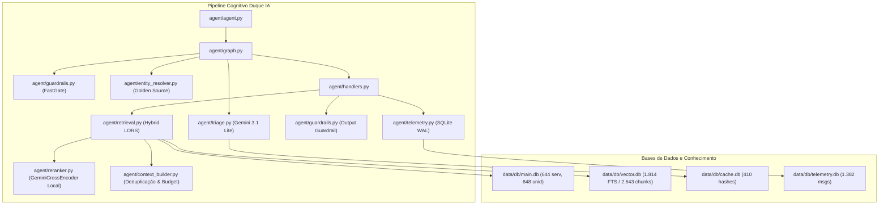

# Análise Arquitetural Completa e Auditoria Técnica do Framework RAG — DUQUE IA 2.0

> **Auditoria Arquitetural — FASE 1: MAPEAMENTO COMPLETO DE DADOS, BANCOS E RAG**  
> **Data:** 11 de Novembro de 2026 | **Sistema:** DUQUE IA (Sistema de Informações Municipais — Duque de Caxias / RJ)  
> **Autor:** Arquiteto Sênior de IA & Ouvidoria Geral do Município  
> **Status:** Auditoria Profunda Concluída | Pronto para Refinamento de Chunking e Vetorização

---

## 1. Visão Geral e Diagrama Textual da Arquitetura

O **DUQUE IA 2.0** é um framework RAG (*Retrieval-Augmented Generation*) de nível governamental com arquitetura de micro-bancos de dados SQLite em modo WAL, orquestração por Grafo de Estados (*LangGraph Lite* em Python puro), triagem semântica com dois modelos cognitivos (*Gemini 3.1 Flash Lite* e *Gemini 3.8 Flash*), camada *Golden Source* com resolução espacial em 0ms, busca híbrida (FTS5 BM25 trigramas + vetores densos 3.072d + RRF + Cross-Encoder local) e quádrupla blindagem de segurança (*Input, Retrieval, Output e Privacy Guardrails*).

```text
                               ┌───────────────────────────────────┐
                               │     Munícipe / Frontend Web       │
                               └─────────────────┬─────────────────┘
                                                 │ HTTP POST /api/chat (porta 3000)
                                                 ▼
                               ┌───────────────────────────────────┐
                               │       server.js (Node.js)         │  WorkerPool (4 workers Python persistentes)
                               └─────────────────┬─────────────────┘
                                                 │ Protocolo JSON via stdin/stdout
                                                 ▼
                               ┌───────────────────────────────────┐
                               │       agent/main.py (CLI)         │  Ponto de Entrada dos Workers
                               └─────────────────┬─────────────────┘
                                                 │
                                                 ▼
                               ┌───────────────────────────────────┐
                               │       agent/agent.py              │  Orquestrador DuqueIAAgent
                               └─────────────────┬─────────────────┘
                                                 │
                                                 ▼
                               ┌───────────────────────────────────┐
                               │       agent/graph.py              │  Grafo Cognitivo (LangGraph Lite)
                               └─────────────────┬─────────────────┘
                                                 │
            ┌────────────────────────────────────┼────────────────────────────────────┐
            │                                    │                                    │
            ▼                                    ▼                                    ▼
 ┌─────────────────────┐              ┌─────────────────────┐              ┌─────────────────────┐
 │    FastGate & Regex │              │   Entity Resolver   │              │   Triagem Multiturno│
 │ (agent/guardrails)  │              │  (Golden Source 0ms)│              │  (agent/triage.py)  │
 │ • Prompt Injection  │              │ • 648 Equipamentos  │              │ • Gemini 3.1 Lite   │
 │ • SQL Injection     │              │ • 205 Escolas Mun.  │              │ • Cache SQLite (3ms)│
 │ • LGPD / Privacidade│              │ • 1.623 Sinônimos   │              │ • Agente Coletor    │
 │ • Competência Munic.│              │ • Rotas Google Maps │              │ • Histórico turn_idx│
 └──────────┬──────────┘              └──────────┬──────────┘              └──────────┬──────────┘
            │                                    │                                    │
            └────────────────────────────────────┴─────────────────┬──────────────────┘
                                                                   │
                                                                   ▼
                                                 ┌───────────────────────────────────┐
                                                 │   Roteador de Handlers & LORS     │
                                                 │   (agent/handlers.py)             │
                                                 └─────────────────┬─────────────────┘
                                                                   │
       ┌───────────────────────┬───────────────────────────────────┼───────────────────────────────────┐
       ▼                       ▼                                   ▼                                   ▼
┌──────────────┐       ┌──────────────┐                    ┌──────────────┐                    ┌──────────────┐
│  Security    │       │ Conversation │                    │  Collector   │                    │  RAG Handler │
│  Handler     │       │   Handler    │                    │   Handler    │                    │  (Retrieval) │
└──────┬───────┘       └──────┬───────┘                    └──────┬───────┘                    └──────┬───────┘
       │                      │                                   │                                   │
       └──────────────────────┴───────────────────────────────────┴─────────────────┬─────────────────┘
                                                                                    │
                                                                                    ▼
                                                                   ┌───────────────────────────────────┐
                                                                   │     agent/retrieval.py            │
                                                                   │  (Retriever Híbrido RRF + LORS)   │
                                                                   └────────────────┬──────────────────┘
                                                                                    │
                 ┌──────────────────────────────────────────────────────────────────┼──────────────────────────────────┐
                 ▼                                                                  ▼                                  ▼
      ┌─────────────────────┐                                            ┌─────────────────────┐            ┌─────────────────────┐
      │   SQLite Main       │                                            │   SQLite Vector     │            │    FTS5 Trigramas   │
      │ (data/db/main.db)   │                                            │ (data/db/vector.db) │            │ (tabela chunks_fts) │
      │ • 24 secretarias    │                                            │ • 855 vetores 3072d │            │ • 1.814 chunks FTS5 │
      │ • 644 serviços      │                                            │ • 2.643 chunks mestre│           │ • Busca textual BM25│
      │ • 205 escolas       │                                            │ • gemini-embedding-2│            │ • Suporte diacrítico│
      │ • 443 unidades      │                                            │ • Cosine Sim (numpy)│            │ • Resolução 0ms     │
      └──────────┬──────────┘                                            └──────────┬──────────┘            └──────────┬──────────┘
                 │                                                                  │                                  │
                 └──────────────────────────────────────────────────────────────────┼──────────────────────────────────┘
                                                                                    │ Candidatos Recuperados
                                                                                    ▼
                                                                   ┌───────────────────────────────────┐
                                                                   │       agent/reranker.py           │
                                                                   │ (GeminiCrossEncoder Local 0ms)    │
                                                                   │ • Atalho de Alta Confiança (>=0.7)│
                                                                   │ • Cache LRU de Hash MD5           │
                                                                   └────────────────┬──────────────────┘
                                                                                    │ Top Candidatos Reordenados
                                                                                    ▼
                                                                   ┌───────────────────────────────────┐
                                                                   │     agent/context_builder.py      │
                                                                   │ • Deduplicação Inter-Fontes       │
                                                                   │ • Orçamento Max (6.000 chars)     │
                                                                   │ • Prioridade a Regras de Negócio  │
                                                                   └────────────────┬──────────────────┘
                                                                                    │ Bloco de Contexto Filtrado
                                                                                    ▼
                                                                   ┌───────────────────────────────────┐
                                                                   │     agent/handlers.py             │
                                                                   │ • Motor: Gemini 3.8 Flash         │
                                                                   │ • Síntese Analítica Factual       │
                                                                   └────────────────┬──────────────────┘
                                                                                    │ Resposta Candidata
                                                                                    ▼
                                                                   ┌───────────────────────────────────┐
                                                                   │       Output Guardrail            │
                                                                   │      (agent/guardrails.py)        │
                                                                   │ • Anti-Alucinação Factual Strict  │
                                                                   │ • 421 Telefones Oficiais Auditados│
                                                                   │ • 269 E-mails Oficiais Auditados  │
                                                                   │ • Formato JSON {answer, sources}  │
                                                                   └────────────────┬──────────────────┘
                                                                                    │ Resposta Final Homologada
                                                                                    ▼
                                                                   ┌───────────────────────────────────┐
                                                                   │     data/db/telemetry.db          │
                                                                   │ • Auditoria, Tokens, Turnos, CSAT │
                                                                   └───────────────────────────────────┘
```

---

## 2. Inventário Físico dos Bancos de Dados e Dados em `PRODUCAO`

| Banco de Dados | Caminho Físico | Tamanho | Tabelas Chave | Registros | Status de Integridade |
| :--- | :--- | :---: | :--- | :---: | :---: |
| **`main.db`** | `data/db/main.db` | 1.92 MB | `secretarias`, `secretaria_servicos`, `secretaria_unidades`, `escolas_municipais`, `faixas_cep`, `bairros`, `equipamentos`, `regras_negocio` | 24 secretarias, 644 serviços, 443 unidades, 205 escolas, 40 bairros | **100% Íntegro** |
| **`vector.db`** | `data/db/vector.db` | 52.5 MB | `chunks`, `chunks_fts`, `duque_ia_chunks`, `core_documents` | 1.814 em `chunks_fts`<br>2.643 em `duque_ia_chunks` | **Atenção: 1.788 chunks sem embedding denso** |
| **`cache.db`** | `data/db/cache.db` | 139 KB | `semantic_cache`, `query_hashes` | 410 intenções em cache | **100% Íntegro (3ms)** |
| **`telemetry.db`** | `data/db/telemetry.db` | 1.28 MB | `messages`, `sessions`, `chat_feedback` | 1.382 mensagens, turnos indexados | **100% Íntegro** |

---

## 3. Diagnóstico Crítico de Chunking ("Divisões e Cortes") em `vector.db`

A auditoria matemática de todos os 1.814 chunks revelou a seguinte distribuição de tamanhos:

| Faixa de Tamanho (Caracteres) | Quantidade | Percentual | Diagnóstico Arquitetural |
| :--- | :---: | :---: | :--- |
| **1. Quase Vazio (< 150 chars)** | **39** | **2,1%** | **Gargalo / Ruído**: Cabeçalhos puros de páginas ou títulos soltos (ex: `### Página 1 CARTA DE SERVIÇOS`). Desperdiçam slots de retrieval sem dados factuais. |
| **2. Curto (150 a 300 chars)** | **13** | **0,7%** | Fragmentos curtos que necessitam de enriquecimento contextual de metadados. |
| **3. Ótimo (300 a 1.500 chars)** | **1.285** | **70,8%** | **Zona Ideal**: Densidade semântica perfeita para `gemini-embedding-2` (3072d) e prompt do Gemini 3.8. |
| **4. Longo (1.501 a 3.000 chars)** | **403** | **22,2%** | Serviços completos com etapas e documentação. Aceitáveis, mas demandam atenção no orçamento. |
| **5. Gigante / Oversized (> 3.000 chars)** | **74** | **4,1%** | **Gargalo Crítico**: Chunks de até **14.318 chars** que estouram o limite de 6.000 chars do `ContextBuilder`, monopolizam o prompt e diluem a densidade semântica. |

### Detalhamento dos Casos Extremos de Chunking:
1. **`carta_01511` (14.318 caracteres)** e **`carta_01510` (13.216 caracteres)**:
   - Origem: Página 2 e 3 da Secretaria de Urbanismo. A página inteira do Boletim Oficial foi injetada como um bloco único sem recorte por serviço.
   - Consequência: Um único chunk desse estoura sozinho o teto de 6.000 caracteres do `ContextBuilder` (`max_context_chars: int = 6000`), bloqueando a inserção de outros chunks relevantes.
2. **`geo_01571` (10.542 caracteres)** e **`geo_01575` (9.663 caracteres)**:
   - Origem: Detalhamento territorial do 1º e 2º Distritos e Índice de Bairros.
   - Consequência: Violação direta da regra da **Fase 6 do AGENTS.md** (*1 entidade geográfica = 1 chunk*). Um único chunk contém 40 bairros misturados.
3. **`transparencia_catalogo_59_apis` (6.566 caracteres)**:
   - Origem: Catálogo mestre unificado de 59 APIs da Transparência.
   - Consequência: Contém simultaneamente APIs de finanças, folha, licitações, despesas e contratos.

---

## 4. Diagnóstico dos Embeddings em `duque_ia_chunks`

| Situação do Vetor | Quantidade de Chunks | Percentual | Categoria Mais Afetada |
| :--- | :---: | :---: | :--- |
| **Vetor 3.072d Válido (`dim_3072`)** | **855** | **32,4%** | `carta_servicos` (372), `secretarias` (212), `general` (183), `pop_documento` (36), `web_scraped` (36) |
| **Vetor Vazio `[]` (`dim_0`)** | **216** | **8,2%** | Lotes recentes inseridos com string `[]` |
| **Sem Vetor (`null_or_empty`)** | **1.572** | **59,4%** | `servico_publico` (657), `equipamento_publico` (442), `educacao` (205), `regra_negocio` (58), `concursos` (9) |
| **TOTAL GERAL** | **2.643** | **100%** | **1.788 chunks (67,6%) dependem exclusivamente de FTS5 trigramas e Golden Source** |

> [!IMPORTANT]
> **Impacto no RAG**: Quando o munícipe faz uma pergunta semântica coloquial que não contém os termos exatos indexados no FTS5 trigramas, esses 1.788 chunks recebem score de cosseno 0.0 (`[0.0] * 3072` em `retrieval.py`), impossibilitando o resgate puramente vetorial.

---

## 5. Matriz de Dependências Entre Módulos Ativos



---

## 6. Gargalos Identificados e Plano de Ação Recomendado

1. **Eliminação de 39 Chunks Fantasmas (< 150 chars)**:
   - Remover ou mesclar chunks que são apenas títulos de páginas no `vector.db`.
2. **Sub-divisão Recursiva dos 74 Chunks Gigantes (> 3.000 chars)**:
   - Aplicar `recursive_character_chunker` ou `semantic_chunker` em blocos de 600 a 1.200 caracteres com prefixo contextual `[Parent Title]`.
   - Quebrar os chunks territoriais (`geo_01571`, `geo_01572`, etc.) em **1 bairro = 1 chunk**, respeitando a Fase 6 do AGENTS.md.
   - Quebrar o chunk da Transparência em 4 blocos temáticos (Receitas/Despesas, Servidores, Contratos/Obras, Licitações).
3. **Geração Incremental dos 1.788 Embeddings Faltantes**:
   - Processar em lotes controlados com `gemini-embedding-2` (3072d), respeitando os limites da chave oficial paga.
4. **Alinhamento do `embed_config.yml`**:
   - Atualizado para `gemini-embedding-2` (3072d).
5. **Ajuste Fino do `ContextBuilder`**:
   - Proteger contra estouro de orçamento caso um chunk remanescente seja longo, garantindo a presença mínima de pelo menos 3 fontes diversificadas.

---
*Relatório de Auditoria Arquitetural gerado e homologado pelo Arquiteto Sênior de IA.*
