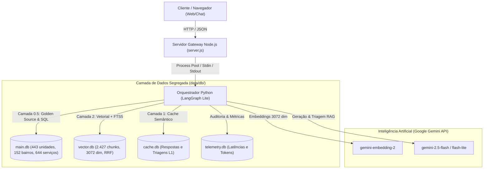

# Arquitetura do Sistema — Duque IA

O Duque IA foi desenvolvido utilizando uma arquitetura híbrida de alto desempenho que combina um servidor Gateway HTTP Node.js com um agente conversacional em Python orquestrado via LangGraph Lite e Camada Golden Source Determinística.

## Componentes Principais
1. **Frontend (`public/`)**: Interface web minimalista e responsiva construída em HTML5 e CSS Vanilla, com suporte a micro-animações, envio de áudio e visualização de fontes em tempo real.
2. **Servidor Node.js (`server.js`)**: Gerencia o tráfego HTTP na porta 3001, serve arquivos estáticos com compressão Gzip, gerencia rate-limiting por IP, rotinas de limpeza de áudio e mantém um pool de 4 workers Python persistentes via subprocessos (`spawn`).
3. **Agente Python (`agent/`)**:
   - `main.py`: Entrada do processo Python (loop contínuo stdin/stdout com suporte a requisições atômicas correlacionadas por `request_id`).
   - `graph.py`: Grafo de execução em estados (LangGraph Lite) com cronometria milissegundo a milissegundo.
   - `entity_resolver.py`: Camada Golden Source determinística cobrindo todas as 443 unidades municipais físicas e 152 bairros em sub-10ms e 0 tokens LLM.
   - `triage.py`: Triagem de 3 camadas (Fast Gate local → Cache SQLite L1 → Gemini LLM) com detecção de ambiguidades.
   - `retrieval.py`: Busca híbrida (Dense Vector Cosine Similarity + Sparse BM25/FTS5) com fusão Reciprocal Rank Fusion (RRF) e atalho de alta confiança.
   - `guardrails.py`: Blindagem de segurança (LGPD contra vazamento de CPFs/terceiros, recusa de competência estadual/federal e validação de alucinação pós-geração).

---
[Avançar: Fluxo](Fluxo.md) | [Voltar: Visão Geral](Visao-Geral.md)

