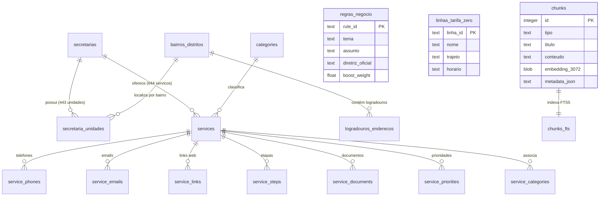

# Diagrama Entidade-Relacionamento (DER) — Duque IA

O Duque IA opera sobre uma arquitetura de banco de dados segregada em `data/db/` para concorrência em modo WAL. Abaixo está o modelo de entidades relacionais e vetoriais:

## Estrutura por Instância de Banco
1. **`main.db` (Ontologia & Dados Mestres)**:
   - **`secretarias` (20)**: Estrutura executiva municipal com código, endereço, titular e contatos.
   - **`secretaria_unidades` (443)**: Equipamentos físicos (CRAS, Postos de Saúde, Escolas, UPHs, UPAs, FUNDEC).
   - **`services` (644)**: Catálogo oficial da Carta de Serviços com etapas, documentos e canais de acesso.
   - **`bairros_distritos` (152)**: Bairros oficiais, apelidos fonéticos e distritos (1º ao 4º).
   - **`logradouros_enderecos` (400)**: Vias públicas e logradouros mapeados por bairro.
   - **`regras_negocio`**: Diretrizes canônicas municipais com fator de boost prioritário no RRF.
   - **`linhas_tarifa_zero`**: Itinerários e horários de transporte público municipal gratuito.

2. **`vector.db` (Motor de Busca Semântica RAG)**:
   - **`chunks` (2.427)**: Chunks de documentos com representações vetoriais de 3072 dimensões (`gemini-embedding-2`).
   - **`chunks_fts`**: Tabela virtual SQLite FTS5 para busca BM25 e fusão com busca vetorial via Reciprocal Rank Fusion (RRF).
   - **`embedding_metadata`**: Guarda modelo ativo e dimensionalidade para validação estrita.

3. **`cache.db` (Cache L1)**:
   - Respostas e triagens de perguntas frequentes para latência sub-segundo.

4. **`telemetry.db` (Observabilidade)**:
   - Registro de latências por nó do LangGraph Lite, consumo de tokens e custo estimado em USD.

---
[Avançar: Dicionário](Dicionario.md) | [Voltar: Banco](Banco.md)

