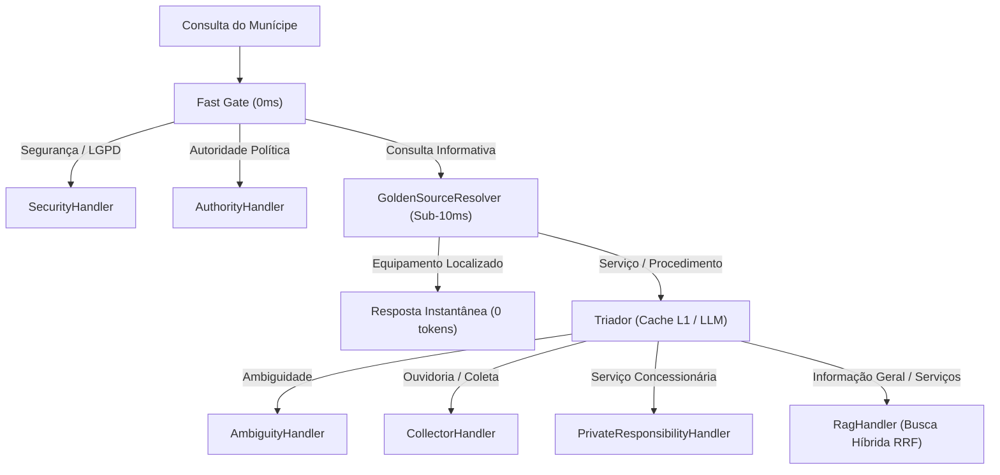

# Agentes Autônomos e Handlers do Duque IA

A arquitetura do Duque IA é orquestrada por um grafo de estados (*LangGraph Lite*) que distribui o processamento entre micro-agentes e handlers especializados com responsabilidade única:

---

## 1. Camadas Pré-RAG (0ms a Sub-10ms)

### 🔹 Camada 0: Fast Gate (`agent/triage.py`)
- **Latência:** `< 1 ms`
- **Função:** Interceptação ultra-rápida por padrões de regex e expressões regulares locais.
- **Responsabilidades:**
  - Bloqueio imediato de tentativas de Prompt Injection, SQL Injection e vazamento de dados de terceiros/CPFs (LGPD).
  - Roteamento instantâneo de consultas sobre autoridades municipais (`AUTHORITY_HANDLER`) sem invocar LLM.
  - Encaminhamento de consultas procedimentais para a Golden Source Layer.

### 🔹 Camada 0.5: Golden Source Layer (`agent/entity_resolver.py`)
- **Latência:** `< 10 ms` (média de 0,7ms em Python | ~6ms HTTP)
- **Função:** Resolução determinística sobre dados oficiais em banco relacional (`main.db`), com 100% de precisão e custo zero de tokens LLM.
- **Cobertura:**
  - **443 Unidades Físicas Municipais:** CRAS, CREAS, UPAs 24h, UPHs 24h, Hospitais, Clínicas da Família, Postos de Saúde, Escolas Municipais, CIEPs, Creches, Polos FUNDEC, Conselhos Tutelares, Defesa Civil, Teatro Raul Cortez, Museu Ciência e Vida, Vila Olímpica, Restaurante do Povo.
  - **152 Bairros Oficiais:** Mapeamento geográfico completo dos 4 distritos com detecção de apelidos fonéticos locais.
  - **Listagens Consolidadas:** Capacidade de listar todos os equipamentos de uma categoria por distrito (ex: *"Quais as UPAs de Caxias?"*).
  - **Blindagem Procedimental:** Não intercepta perguntas de serviços (*"como solicitar poda"*, *"como pagar IPTU"*), repassando-as ao RAG.

---

## 2. Handlers Especializados de Resposta

| Handler | Arquivo / Módulo | Função e Comportamento |
| :--- | :--- | :--- |
| **`GoldenSourceResolver`** | `agent/entity_resolver.py` | Entrega instantânea de endereços, telefones oficiais, secretarias e horários de atendimento. |
| **`AuthorityHandler`** | `agent/handlers/authority.py` | Responde com precisão canônica quem é o Prefeito, Vice-Prefeito, Secretários Municipais e Ouvidor Geral. |
| **`SecurityHandler`** | `agent/handlers/security.py` | Aplica as diretrizes de LGPD (recusa dados de terceiros) e competência municipal (rejeita metrô, previdência federal, etc.). |
| **`CollectorHandler`** | `agent/handlers/collector.py` | Agente Coletor incremental de manifestações (solicita **uma** informação por vez: endereço, referência) antes de direcionar ao aplicativo **Colab**. |
| **`AmbiguityHandler`** | `agent/handlers/ambiguity.py` | Gera perguntas de esclarecimento contextualizadas quando a consulta do munícipe é vaga (*"quero falar sobre obras"*). |
| **`PrivateResponsibilityHandler`**| `agent/handlers/private.py` | Orienta munícipes sobre serviços de competência privada ou de concessionárias (ex: falta de luz na residência / Light). |
| **`ProgramacaoHandler`** | `agent/handlers/programacao.py`| Consulta a agenda cultural, eventos municipais e programações nos teatros e praças de Duque de Caxias. |
| **`RagHandler`** | `agent/handlers/rag.py` | Executa busca híbrida (Vetor 3072 dim + BM25/FTS5 via RRF), reranker de alta confiança e formulação final via Gemini com citações e guardrail anti-alucinação. |

---

## 3. Fluxo de Vida dos Agentes no Grafo

---
[Avançar: Deploy](../08-Deploy/Producao.md) | [Voltar: Fluxos](Fluxos.md)

