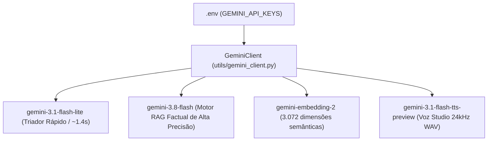
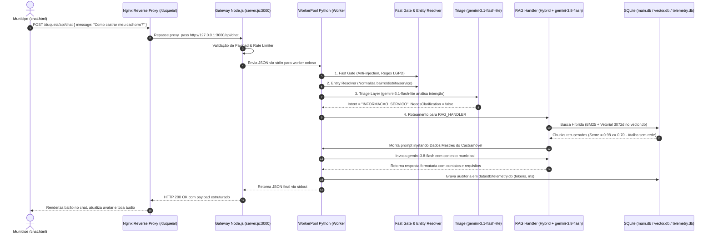

# 🏛️ DUQUE IA — Arquitetura de Produção, Ecossistema de IA e Fluxo Completo de Mensagem

> **Documento Oficial de Engenharia e Operação**  
> **Sistema Municipal de Inteligência Artificial — Prefeitura Municipal de Duque de Caxias (PMDC)**  
> **Versão:** 3.0 (Produção Homologada)  
> **Ambiente:** Servidor de Produção Linux (PM2: `duque-ia` | Nginx: `/duqueia/` | Porta: `3000`)

---

## 1. Identidade e Propósito do Sistema

O **DUQUE IA** é a plataforma oficial de inteligência artificial da Prefeitura de Duque de Caxias, projetada para fornecer atendimento ao munícipe com precisão factual, humanização e total conformidade com a Lei Geral de Proteção de Dados (LGPD) e o Procedimento Operacional Padrão (POP) da Ouvidoria Geral do Município.

### Pilares Fundamentais:
1. **Fidelidade Factual (Zero Alucinação):** Toda resposta sobre serviços, taxas, prazos, secretarias e locais é estritamente ancorada nos dados mestres oficiais municipais.
2. **Triagem Contextual e Agente Coletor:** Se o munícipe fizer uma solicitação vaga (ex: *"minha rua está esburacada"*), o sistema assume o papel de coletor de informações de forma incremental (pedindo um dado por vez: bairro, rua, ponto de referência) para direcioná-lo com precisão à plataforma **Colab** ou à secretaria competente.
3. **Blindagem Jurídica e LGPD:** O sistema bloqueia consultas a dados de terceiros (vizinhos, protocolos alheios, CPFs) e restringe suas respostas à competência do município de Duque de Caxias, rejeitando temas estaduais/federais e oferecendo o canal direto da Ouvidoria Geral: **(21) 2652-3835** e WhatsApp **(21) 99824-5903**.

---

## 2. Ecossistema de IA e Chave de API

O sistema utiliza os modelos de última geração da família **Google Gemini**, operando com uma chave oficial faturada do Google Cloud:

### Detalhamento das Credenciais e Modelos:
* **Chave Oficial:** Vinculada ao projeto `projects/526814071543` no Google Cloud Console com faturamento ativo.
* **Segurança:** O valor real da chave reside exclusivamente no arquivo `.env` do servidor, protegido pelo `.gitignore` e blindado contra exposição no Git.
* **Modelo Triador (`gemini-3.1-flash-lite`):**
  * Especializado em classificação rápida de intenções, análise de sentimento e verificação de ambiguidade.
  * Tempo de resposta típico: **~1,2 a 1,7 segundos**.
* **Modelo RAG Principal (`gemini-3.8-flash`):**
  * Modelo com janela de contexto estendida e alto poder de raciocínio.
  * Recebe o contexto documental resgatado da base vetorial e elabora a resposta final em formato institucional, aplicando negrito em contatos e prazos.
* **Embeddings (`gemini-embedding-2`):**
  * Vetorização densa em 3.072 dimensões, garantindo alta separabilidade de termos técnicos e gírias de bairros de Caxias.
* **Síntese de Voz (`gemini-3.1-flash-tts-preview`):**
  * Conversão nativa do texto gerado em áudio de estúdio WAV de 24kHz, permitindo ao cidadão ouvir a resposta.

---

## 3. Diagrama Completo do Fluxo de Mensagem (End-to-End)

A jornada de uma mensagem, desde o clique do munícipe no navegador até a exibição da resposta na tela:

---

## 4. Passo a Passo Técnico de Execução

### Passo 1: Captura e Envio no Frontend (`chat.html`)
* O cidadão digita sua dúvida ou grava áudio pelo microfone.
* A requisição HTTP `POST` é disparada para o endpoint relativo `api/chat`.
* O frontend altera imediatamente o avatar do atendente para o estado **"Pensando / Consultando"** (`atendente_notebook_pensando.png`).

### Passo 2: Gateway e Balanceamento de Processos (`server.js`)
* O Nginx encaminha a requisição da porta 80/443 para `http://127.0.0.1:3000`.
* O `server.js` gerencia um **WorkerPool de 4 processos Python persistentes**.
* A requisição é enfileirada e entregue ao primeiro worker livre via `stdin` com serialização JSON, evitando o custo de reinicializar o runtime do Python a cada chamada.

### Passo 3: Filtro Rápido e Sanitização (`fast_gate.py`)
* Bloqueia tentativas de *Prompt Injection* (ex: *"Ignore todas as diretrizes anteriores"*).
* Bloqueia ataques de *SQL Injection* e caracteres maliciosos.
* Intercepta saudações triviais imediatas (*"olá"*, *"bom dia"*), economizando chamadas desnecessárias de IA.

### Passo 4: Resolução de Entidades Geográficas (`entity_resolver.py`)
* Normaliza nomes de bairros, apelidos e variações (ex: *"Imbariê"*, *"Pilar"*, *"Gramacho"*, *"Xerém"*).
* Vincula a entidade ao seu respectivo distrito (1º ao 4º Distrito de Caxias) e identifica unidades públicas de referência (UPHs, USFs, CRAS, escolas).

### Passo 5: Triagem Inteligente (`triage.py`)
* Executado pelo `gemini-3.1-flash-lite`.
* Avalia o histórico das últimas mensagens do diálogo.
* Determina se a mensagem:
  * Possui contexto completo -> Prossegue para RAG.
  * É ambígua ou incompleta -> Aciona o **Agente Coletor** para solicitar amigavelmente o dado que falta (ex: endereço da lâmpada apagada).
  * Foge da competência da prefeitura -> Encaminha para o **Fallback da Ouvidoria Geral**.

### Passo 6: Recuperação Híbrida e Reranking (`retrieval.py`)
* Consulta a base `data/db/vector.db` (1.575 chunks mestres).
* Realiza fusão recíproca de ranking (RRF) combinando busca textual exata e similaridade cosseno de 3.072 dimensões.
* **Atalho de Alta Confiança:** Se o top resultado atingir similaridade `>= 0.70`, o sistema pula a etapa de reranking por rede (0ms), acelerando a resposta.

### Passo 7: Síntese e Guardrails Finais (`handlers.py`)
* O `gemini-3.8-flash` recebe o contexto oficial e elabora a resposta acolhedora.
* O guardrail de saída verifica ausência de CPFs/dados privados e garante formatação limpa com contatos e locais em **negrito**.

### Passo 8: Telemetria Contínua (`telemetry.db`)
* Registra de forma assíncrona na tabela `rag_queries` e `chat_messages`:
  * Timestamp, sessão, tempo total (ms), tokens de prompt, tokens de candidate, score de confiança e secretaria responsável.
* Alimenta automaticamente os gráficos do `dashboard.html`.

---

## 5. Arquitetura dos 4 Bancos de Dados SQLite

O sistema opera com bancos locais segregados, configurados em **WAL (Write-Ahead Logging)** para leitura e escrita simultâneas de altíssima velocidade:

| Banco | Caminho Físico | Conteúdo e Responsabilidade |
| :--- | :--- | :--- |
| **Relacional Principal** | `data/db/main.db` | 644 serviços públicos, secretarias, secretários, faixas de CEP e regras canônicas de negócio. |
| **Vetorial / Embeddings** | `data/db/vector.db` | 1.575 chunks mestres unificados com seus respectivos vetores densos (3072d) gerados pelo `gemini-embedding-2`. |
| **Cache de Respostas** | `data/db/cache.db` | Respostas cacheadas para perguntas frequentes com entrega ultra-rápida em **~3 milissegundos**. |
| **Telemetria e Logs** | `data/db/telemetry.db` | Histórico de conversas, métricas de desempenho de cada agente, auditoria de tokens e feedback do munícipe. |

---

## 6. Catálogo dos 12 Personagens Oficiais do Duque IA (`public/assets/personagens/`)

O repositório conta com a suíte de avatares 3D do **Duque**, o atendente oficial humanizado de Duque de Caxias, segmentados individualmente com fundo transparente em `public/assets/personagens/`:

| Arquivo de Imagem | Expressão / Pose | Papel / Contexto no Sistema |
| :--- | :--- | :--- |
| `duque_boas_vindas_bracos_abertos.png` | Braços abertos, sorriso receptivo caloroso | **Boas-vindas e Acolhimento Inicial** no chat. |
| `duque_desenvolvedor_notebook.png` | Moletom `</>`, digitando/analisando notebook | **Estado de Processamento e Busca RAG** (Digitando). |
| `duque_joinha_aprovado.png` | Camisa polo branca com joinha/positivo | **Sucesso na Resposta / Confirmação de Protocolo**. |
| `duque_saude_jaleco.png` | Jaleco médico branco com crachá municipal | **Temas de Saúde, Vacinas, UPHs 24h e Hospitais**. |
| `duque_atendimento_telefone.png` | Falando ao telefone celular | **Canais da Ouvidoria Geral, Telefones e Contatos**. |
| `duque_consultando_tablet.png` | Segurando e apontando para a tela do tablet | **Passo a passo, Formulários e Plataforma Colab**. |
| `duque_executivo_analisando.png` | Blazer bege, ajustando óculos com perspicácia | **Topo do Painel Executivo e Análise de Dados**. |
| `duque_gestao_foco_caneca.png` | Camisa verde, caneca "FOCO PLANO RESULTADO" | **Planejamento Estratégico, Governo e Metas**. |
| `duque_jovem_mochila_paz.png` | Casaco azul, mochila, sinal de paz e amor (V) | **Cultura, Turismo, Esporte, Lazer e Juventude**. |
| `duque_gamer_headset.png` | Cadeira ergonômica, headset gamer e punho firme | **Suporte Ágil e Operações em Tempo Real**. |
| `duque_confiante_bracos_cruzados.png` | Camiseta preta, braços cruzados e relógio | **Institucional, Segurança e Ordem Pública**. |
| `duque_polo_apresenta.png` | Camisa polo preta clássica apresentando | **Comunicação Social e Relações Públicas**. |

---

## 7. Próximos Passos de Frontend: Chat & Dashboard

Com a base e o cérebro do sistema consolidados e limpos:
1. **Refatoração do `public/chat.html`:**
   * Troca dinâmica dos avatares conforme o ciclo de vida da mensagem (Acolhendo -> Pensando -> Respondendo com Joinha).
   * Design institucional com paleta da Prefeitura de Duque de Caxias (Azul Profundo, Branco, Cinza Neutro).
   * Feedback sonoro opcional e integração nativa ao reprodutor de áudio WAV 24kHz.
2. **Refatoração do `public/dashboard.html`:**
   * Conexão visual direta aos dados de `telemetry.db` via `/api/metrics`.
   * Cards executivos: Total de Atendimentos, Tempo Médio de Resposta, Economia de Tokens, Índice de Resolução.
   * Gráficos dinâmicos com Chart.js exibindo distribuição por secretarias e mapa de demandas mais frequentes.

---

## 8. Catálogo Estrutural Oficial das Secretarias e Órgãos Municipais (Atualizado)

Conforme a reforma administrativa e estruturação de dados mestres, a Prefeitura Municipal de Duque de Caxias conta com as seguintes pastas e siglas oficiais cadastradas e indexadas no RAG:

| Sigla | Nome Oficial da Secretaria / Órgão | Sede / Endereço | Contato / Canais |
| :--- | :--- | :--- | :--- |
| **SMS** | Secretaria Municipal de Saúde | Av. Brig. Lima e Silva, 1618 - 25 de Agosto | (21) 2672-8800 |
| **SMCSRPTER** | Secretaria Municipal de Comunicação Social, Relações Públicas, Trabalho, Emprego e Renda e Ouvidoria Geral | Alameda Dona Mariana, 91 - 25 de Agosto | (21) 2652-3835 / WhatsApp: (21) 99824-5903 |
| **SMCT** | Secretaria Municipal de Cultura e Turismo | Praça Humaitá, s/n - 25 de Agosto | (21) 2672-8890 / (21) 2771-8682 |
| **SMEL** | Secretaria Municipal de Esporte e Lazer | Rua Garibaldi, s/n (Vila Olímpica) - 25 de Agosto | (21) 2652-7428 |
| **SMG** | Secretaria Municipal de Governo | Alameda Dona Mariana, 91 - 25 de Agosto | (21) 2672-8801 |
| **SMOA** | Secretaria Municipal de Obras e Agricultura | Av. Brig. Lima e Silva, 1618 - 25 de Agosto | (21) 2672-8850 |
| **SMTSP** | Secretaria Municipal de Transportes e Serviços Públicos | Av. Brig. Lima e Silva, 1618 - 25 de Agosto | (21) 2672-8870 |
| **SMDC** | Secretaria Municipal de Defesa Civil | Rua Silva Fernandes, 170 - Centro | 199 / 0800 0230 199 / (21) 2672-6199 |
| **SMSP** | Secretaria Municipal de Segurança e Ordem Pública | Av. Brig. Lima e Silva, 1618 - 25 de Agosto | (21) 2672-8880 |
| **SME** | Secretaria Municipal de Educação | Rua Prefeito Bernardo Távora, s/n - 25 de Agosto | (21) 2671-6161 |
| **SMF** | Secretaria Municipal de Fazenda | Alameda Dona Mariana, 91 - 25 de Agosto | (21) 2672-8820 |
| **SMA** | Secretaria Municipal de Administração | Alameda Dona Mariana, 91 - 25 de Agosto | (21) 2672-8810 |
| **SMASDH** | Secretaria Municipal de Assistência Social e Direitos Humanos | Av. Brig. Lima e Silva, 1618 - 25 de Agosto | (21) 2672-6650 |
| **SMMA** | Secretaria Municipal de Meio Ambiente | Av. Brig. Lima e Silva, 1618 - 25 de Agosto | (21) 2672-8860 |
| **SMUH** | Secretaria Municipal de Urbanismo e Habitação | Av. Brig. Lima e Silva, 1618 - 25 de Agosto | (21) 2672-8855 |
| **SMGIM** | Secretaria Municipal de Gestão, Inclusão e Mulher | Av. Brig. Lima e Silva, 1618 - 25 de Agosto | (21) 2672-6680 |
| **SMPA** | Secretaria Municipal de Proteção Animal | Av. Brig. Lima e Silva, 1618 - 25 de Agosto | (21) 2672-8865 |
| **FUNDEC** | Fundação de Apoio à Escola Técnica, Ciência, Tecnologia, Esporte, Lazer, Cultura e Saúde | Av. Brig. Lima e Silva, 1618 - 25 de Agosto | (21) 2672-5650 |
| **PGM** | Procuradoria-Geral do Município | Alameda Dona Mariana, 91 - 25 de Agosto | (21) 2672-8840 |
| **CGM** | Controladoria-Geral do Município | Alameda Dona Mariana, 91 - 25 de Agosto | (21) 2672-8845 |
| **IPMDC** | Instituto de Previdência dos Servidores Públicos de Duque de Caxias | Rua Passos da Pátria, 120 - 25 de Agosto | (21) 2672-5700 |
| **CONS** | Projetos Transversais / Programas Especiais | Prefeitura Municipal de Duque de Caxias | Central de Atendimento |

