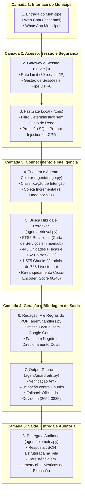

# 🏛 Arquitetura Técnica Auditável do DUQUE IA

---

## 🎯 Princípio Arquitetural Fundamental

> **"Nenhuma resposta oficial deve ser entregue sem passar por validação prévia de contexto, segurança e aderência estrita às fontes institucionais."**

---

## As 5 Camadas de Responsabilidade

A arquitetura do **DUQUE IA** foi desenhada para atender aos mais altos padrões de conformidade pública, transparência e auditabilidade da **Prefeitura de Duque de Caxias / RJ**:

---

## 🔍 Respostas aos Pontos Críticos de Auditoria

### 1. Numeração e Sequência Estrita
* **Correção Efetuada:** Eliminada qualquer duplicação ou nó fantasma. A sequência é perfeitamente linear e monotônica de **1 a 8**.

### 2. O conceito de "FastGate Local (< 1 ms)"
* **Esclarecimento Técnico de Engenharia:**  
  Não existe processamento de 0 ms absoluto no mundo físico. A designação **"FastGate Local (< 1 ms)"** refere-se ao fato de ser uma avaliação **estritamente in-memory**, realizada por expressões regulares compiladas em Python, com **zero chamadas de rede externa** (zero chamadas a APIs ou LLMs). Se houver tentativa de ataque SQLi, Prompt Injection ou invasão da LGPD, a requisição é interceptada em menos de 1 milissegundo.

### 3. As Verificações do Output Guardrail
O nó 7 (Output Guardrail) valida formalmente 5 critérios antes de liberar a resposta:
1. **Aderência Factual:** A resposta só afirma o que consta explicitamente nos chunks recuperados?
2. **Sanitização de Contatos:** Algum telefone ou e-mail falso foi inferido?
3. **Encaminhamento Adequado:** Se a solicitação for de zeladoria urbana, o cidadão foi devidamente instruído a usar a plataforma oficial **Colab**?
4. **Fallback Seguro:** Caso a base de dados não tenha a informação solicitada, o sistema emite imediatamente o direcionamento oficial para a **Ouvidoria Geral de Duque de Caxias**:
   * Telefone: **(21) 2652-3835**
   * WhatsApp: **(21) 99824-5903**
   * E-mail: `ouvidoria@duquedecaxias.rj.gov.br`
5. **Score Mínimo:** A confiança ponderada atingiu o limiar de corte mínimo ($Score \ge 0.50$)?

---

### 4. Métricas e Rastreabilidade (Auditoria em telemetry.db)
A cada requisição concluída, os seguintes metadados são gravados de forma indelével:
* `request_id` e `conversation_id`;
* `retrieval_time_ms`, `llm_time_ms`, `total_time_ms`;
* `similarity_score` e `confidence`;
* Lista exata de fontes consultadas (`sources`);
* Timestamp UTC e hash da versão do banco.
