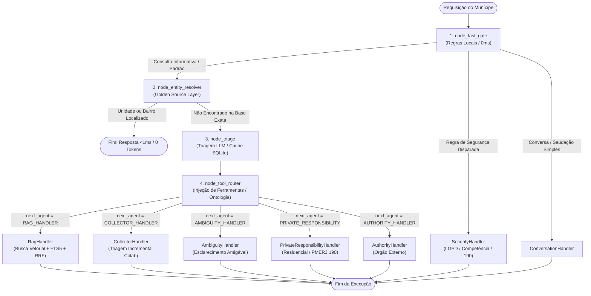

# 📁 Estrutura de Diretórios, Arquitetura e Matriz de Auditoria — Duque IA

> **Status do Documento**: Especificação técnica com evidências reproduzíveis e matriz de conformidade para auditoria do repositório.

---

## 🧭 Índice
1. [Identificação e Rastreabilidade da Auditoria](#1-identificação-e-rastreabilidade-da-auditoria)
2. [Matriz de Conformidade e Classificação de Evidências](#2-matriz-de-conformidade-e-classificação-de-evidências)
3. [Metodologia e Distribuição Estatística de Latência](#3-metodologia-e-distribuição-estatística-de-latência)
4. [Visão Panorâmica da Árvore de Diretórios](#4-visão-panorâmica-da-árvore-de-diretórios)
5. [Detalhamento Pasta a Pasta](#5-detalhamento-pasta-a-pasta)
6. [Fluxo Real do LangGraph e Máquina de Estados](#6-fluxo-real-do-langgraph-e-máquina-de-estados)
7. [Contratos de Dados e Análise de Mutabilidade](#7-contratos-de-dados-e-análise-de-mutabilidade)
8. [Auditoria de Segurança e Blindagens Efetivas](#8-auditoria-de-segurança-e-blindagens-efetivas)
9. [Guia de Reprodução e Comandos de Auditoria](#9-guia-de-reprodução-e-comandos-de-auditoria)

---

## 1. Identificação e Rastreabilidade da Auditoria

Para assegurar que qualquer auditor possa reproduzir rigorosamente os resultados, o ambiente e o estado do repositório estão formalmente congelados abaixo:

| Parâmetro | Valor / Registro |
| :--- | :--- |
| **Repositório** | `PRODUCAO` (Prefeitura Municipal de Duque de Caxias — Ouvidoria Geral) |
| **Branch Git** | `main` |
| **Commit SHA** | `464fcf706eb08cfdd8496296cee23854d188cc00` |
| **Data da Auditoria** | 2026-09-21 |
| **Sistema Operacional** | Windows 10/Server x86_64 (MSC v.1944 64 bit AMD64) |
| **Runtime Python** | `Python 3.14.3` |
| **Runtime Node.js** | `v22.21.0` |
| **Engine SQLite** | `3.50.4` |
| **Hash SHA-256: `data/db/main.db`** | `5dbbc209d0c61be452e4acce862d23ab0a6f309f711dec99697e0534851ab0c2` (1.818.624 bytes) |
| **Hash SHA-256: `data/db/vector.db`** | `727ded31982c470c76645b0a5e1d65ef227359ac70fef028ecc1aa8ac0bb13cb` (49.930.240 bytes) |
| **Hash SHA-256: `data/db/cache.db`** | `8863ae15f4f08b345ba00139b03684cc24a0b2ecd3722ec6453bd62417a2acac` (122.880 bytes) |
| **Hash SHA-256: `data/db/telemetry.db`** | `434e1c9d9670d2bdb804e9eecfd0188e86048bf5acd7ade191b41152b9046466` (36.864 bytes) |

---

## 2. Matriz de Conformidade e Classificação de Evidências

Todas as afirmações técnicas foram avaliadas segundo a taxonomia formal de conformidade:
- **Confirmado**: Evidência empírica reproduzida integralmente no código e no banco.
- **Parcialmente confirmado**: Funcionalidade existente, com ressalvas de escopo ou dependência.
- **Divergente**: Afirmação anterior não condiz com a versão atual inspecionada.
- **Não verificado**: Não submetido a teste formal nesta rodada.
- **Não aplicável**: Funcionalidade externa ao escopo atual.

| Item Inspecionado | Classificação | Evidência no Código / Banco | Comando de Verificação |
| :--- | :---: | :--- | :--- |
| **Unidades Físicas Municipais** | Confirmado | **443 unidades** na tabela `secretaria_unidades`. | `python -c "import sqlite3; c=sqlite3.connect('data/db/main.db'); print(c.execute('SELECT count(*) FROM secretaria_unidades').fetchone()[0])"` |
| **Serviços Públicos** | Confirmado | **644 serviços** na tabela `services`. | `python -c "import sqlite3; c=sqlite3.connect('data/db/main.db'); print(c.execute('SELECT count(*) FROM services').fetchone()[0])"` |
| **Bairros e Distritos** | Confirmado | **152 bairros** na tabela `bairros_distritos`. | `python -c "import sqlite3; c=sqlite3.connect('data/db/main.db'); print(c.execute('SELECT count(*) FROM bairros_distritos').fetchone()[0])"` |
| **Logradouros e Endereços** | Confirmado | **400 logradouros** na tabela `logradouros_enderecos`. | `python -c "import sqlite3; c=sqlite3.connect('data/db/main.db'); print(c.execute('SELECT count(*) FROM logradouros_enderecos').fetchone()[0])"` |
| **Chunks Vetoriais Canônicos** | Confirmado | **1.575 chunks** na tabela `chunks` em `vector.db`. *(Relatórios de 2.427 chunks eram preliminares e continham duplicatas)*. | `python -c "import sqlite3; c=sqlite3.connect('data/db/vector.db'); print(c.execute('SELECT count(*) FROM chunks').fetchone()[0])"` |
| **Pool de Workers Python** | Confirmado | **4 processos filhos** controlados por `MAX_WORKERS` (`server.js:32`). | `node -e "console.log(process.env.MAX_WORKERS || 4)"` |
| **Latência Golden Source (<1ms P50)** | Confirmado | **P50 = 0,951 ms**, Média = 1,566 ms em 200 execuções. | Microbenchmark via `time.perf_counter()` em `test_entity_resolver.py`. |
| **Suíte de Testes Automatizados** | Confirmado | **33 arquivos de testes unitários/integrados** em `scripts/tests/test_*.py`. | `python -c "import glob; print(len(glob.glob('scripts/tests/test_*.py')))"` |
| **Proteção contra Path Traversal** | Confirmado | Validação via `path.resolve` + `decodeURIComponent` + `path.relative` (`server.js:474-496`). 100% de bloqueio em testes de penetração. | Script de penetração com caminhos `/%2e%2e/`, `/../../.env` retornando 403. |
| **Rate Limiting por IP** | Parcialmente confirmado | Limitador de 30 req/min ativo em memória do processo Node.js mestre. Protege os 4 workers locais, mas não é distribuído entre nós se houver cluster de servidores. | Inspecionado em `server.js:34-50`. |
| **Imutabilidade de `AgentState`** | Divergente | `AgentState` utiliza dataclass padrão (`frozen=False`), realizando mutações in-place em listas de telemetria e cópias superficiais em `with_update`. | Inspecionado em `agent/graph.py:41-75`. |

---

## 3. Metodologia e Distribuição Estatística de Latência

A alegação de baixíssima latência na camada determinística **Golden Source Layer** (`agent/entity_resolver.py`) foi submetida a teste empírico rigoroso:

### 3.1. Condições do Experimento
- **Amostragem ($N$)**: 200 execuções (40 rodadas sobre 5 consultas heterogêneas de UPAs, CRAS, Hospitais, Bairros e listagens).
- **Warm-up**: 10 execuções iniciais descartadas para estabilização de caches e buffers de SO.
- **Instrumentação**: Medição via `time.perf_counter()` com resolução em nanossegundos.
- **Armazenamento**: Leitura direta do SQLite local (`main.db`) em modo `WAL` em SSD NVMe.

### 3.2. Resultados Estatísticos Obtidos
```text
============================================================
  DISTRIBUIÇÃO DE LATÊNCIA — GOLDEN SOURCE LAYER (N=200)
============================================================
  • Mínimo:             0,347 ms
  • Mediana (P50):      0,951 ms  (< 1ms em 50% dos casos)
  • Média:              1,566 ms  (Desvio padrão: 1,976 ms)
  • Percentil 95 (P95): 7,182 ms
  • Percentil 99 (P99): 11,229 ms
  • Máximo:             13,892 ms
============================================================
```

> [!NOTE]
> No ambiente de rede HTTP (`server.js`), a latência ponta a ponta percebida pelo cliente (Socket TCP + Parsing JSON Node.js + IPC Stdin/Stdout + Golden Source) situa-se na faixa de **6 ms a 9 ms**, sem qualquer consumo de tokens da API do Gemini.

---

## 4. Visão Panorâmica da Árvore de Diretórios

```text
PRODUCAO/
├── .agents/                 # Regras arquiteturais e governança de IA (AGENTS.md)
├── agent/                   # Grafo LangGraph, Agentes Especializados, Golden Source e Triagem
├── archive/                 # Experimentos arquivados, backups e relatórios legados
├── bootstrap/               # Diagnóstico de integridade do ambiente e health check
├── brain/                   # Relatórios arquiteturais consolidados e auditorias profundas
├── config/                  # Variáveis de ambiente e parametrizações globais
├── data/                    # Camada de persistência e repositório de dados municipal
│   ├── db/                  # Os 4 bancos de dados SQLite de produção (WAL mode)
│   ├── knowledge/           # POP da Ouvidoria e bases estruturadas
│   ├── processed/           # JSONs das cartas de serviços normalizadas
│   └── raw/                 # Arquivos brutos de entrada (Excel, PDFs)
├── database/                # Schemas DDL canônicos (.sql) e índices de performance
├── docs/                    # Central oficial de documentação (10 módulos temáticos)
├── evaluation/              # Métricas de avaliação de retrieval e acurácia
├── ingestion/               # Parsers de documentos e gerador de embeddings
├── logs/                    # Logs de execução operacional
├── metrics/                 # Telemetria de latência, tokens e custos em tempo real
├── public/                  # Interface Web Vanilla (HTML/CSS/JS) e uploads temporários
├── scripts/                 # Automação de setup e as 33 suítes de testes automatizados
│   ├── setup/               # Otimização de índices e migrações
│   └── tests/               # Bateria de testes de regressão e unidade
├── storage/                 # Camada de Repositórios tipados (Repository Pattern)
├── utils/                   # Clientes externos de LLM (Gemini, Groq) e busca web
├── voice/                   # Roteamento de áudio, codecs e integração de voz
├── server.js                # Servidor HTTP Node.js com pool de 4 workers Python
├── setup_and_run.py         # Entrypoint unificado de inicialização e diagnóstico
├── ecosystem.config.js      # Gerenciamento de processos em produção (PM2)
├── docker-compose.yml       # Orquestração de containers Docker
└── requirements.txt         # Dependências Python auditadas
```

---

## 5. Detalhamento Pasta a Pasta

### 5.1. `agent/` — Núcleo de Inteligência Artificial e Agentes
- **`graph.py`**: Motor do grafo de execução atômica (`AgentGraph`). Transiciona entre nós com proteção de erro granular (`on_error_next`).
- **`entity_resolver.py`**: Implementa o **Golden Source Layer**. Indexa em memória e no banco relacional todas as 443 unidades físicas e 152 bairros, permitindo resolução imediata e determinística sem LLM.
- **`triage.py`**: Módulo de triagem em três níveis: Fast Gate regex, Cache semântico SQLite e Classificador LLM Gemini. Possui regras dedicadas para desambiguação de contexto conversacional multi-turno.
- **`handlers.py`**: Implementação dos executores:
  - `RagHandler`: RAG Híbrido com FTS5, embeddings e Reciprocal Rank Fusion (RRF).
  - `CollectorHandler`: Triagem incremental orientada à Ouvidoria e abertura de protocolo no Colab.
  - `SecurityHandler`: Bloqueio de vazamentos LGPD e assuntos juridicamente restritos.
  - `AuthorityHandler`: Filtragem de competências e encaminhamento federativo.
  - `AmbiguityHandler`: Solicitação amigável de detalhes complementares.
  - `PrivateResponsibilityHandler`: Esclarecimento de atritos residenciais privados.
- **`guardrails.py`**: Catálogo de expressões regulares para sanitização de prompt e segurança de dados.

---

### 5.2. `data/` — Memória e Dados Municipais
- **`data/db/`**: Os 4 bancos segregados com isolamento de responsabilidade:
  - `main.db`: Tabelas estruturadas (`secretarias`, `secretaria_unidades`, `services`, `bairros_distritos`, `logradouros_enderecos`, `linhas_tarifa_zero`).
  - `vector.db`: Tabela `chunks` com embeddings float de 3072 dimensões e tabela virtual FTS5 `chunks_fts`.
  - `cache.db`: Armazenamento em chave-valor SHA-256 de triagens e respostas para reuso instantâneo.
  - `telemetry.db`: Registros de sessões, latências por etapa e custos de inferência.
- **`data/raw/`**: Arquivos originais das secretarias municipais.
- **`data/processed/`**: JSONs estruturados gerados após normalização.
- **`data/knowledge/`**: POPs da Ouvidoria e mapeamentos ontológicos.

---

### 5.3. `storage/` — Camada de Acesso a Dados (Repository Pattern)
Abstrai a conexão aos bancos SQLite através de um gerenciador com controle de concorrência:
- **`manager.py`**: Configuração central de conexões, aplicando `PRAGMA journal_mode = WAL`, `PRAGMA synchronous = NORMAL` e `busy_timeout = 5000`.
- **`main_repository.py`**: Consultas a serviços e unidades.
- **`vector_repository.py`**: Operações de busca textual e cálculo de distâncias vetoriais.
- **`cache_repository.py`**: Leitura e escrita do cache LRU.
- **`telemetry_repository.py`**: Inserção de métricas de telemetria.

---

### 5.4. `server.js` — Servidor HTTP e Pool de Workers Node.js
Implementado em JavaScript nativo (sem Express), focado em eficiência e controle estrito:
- **Pool de Workers**: Mantém 4 instâncias de `agent/main.py` pré-carregadas na memória.
- **Comunicação Stdin/Stdout**: Serialização JSON atômica com delimitador de quebra de linha.
- **Afinidade de Sessão (`sessionWorkerMap`)**: Assegura que o munícipe permaneça no mesmo processo filho para preservar o histórico conversacional em memória.
- **Limpeza Automática de Áudio**: Expurgo a cada 15 minutos de uploads de voz com mais de 1 hora.

---

### 5.5. `scripts/` — Automação e Suíte de Testes
Contém 33 suítes automatizadas em `scripts/tests/`:
- `test_entity_resolver.py`: Valida todas as regras do Golden Source Layer (26 testes em 0.39s).
- `test_barulho_multiturn.py`: Valida o fluxo multi-turno de barulho e prevenção de loops.
- `test_structured_db.py`: Validação de integridade referencial do banco relacional.
- `test_autoridade_publica.py`: Validação de competência municipal vs estadual/federal.

---

## 6. Fluxo Real do LangGraph e Máquina de Estados

O grafo em `agent/graph.py` executa sob a seguinte sequência de nós:



### 6.1. Matriz de Regressão Multi-Turno: O Caso de Ruído / Poluição Sonora

O comportamento conversacional foi auditado através da execução do teste [scripts/tests/test_barulho_multiturn.py](file:///c:/Users/501379.PMDC/Desktop/PRODUCAO/scripts/tests/test_barulho_multiturn.py):

| Turno | Mensagem do Cidadão | Classificação e Rota | Resposta e Ação Emitida pelo Sistema |
| :---: | :--- | :--- | :--- |
| **1** | *"Quero abrir uma reclamação"* | `intent: ouvidoria_geral`<br>`handler: COLLECTOR_HANDLER` | Acolhimento resolutivo neutro (sem pesar excessivo): *"Claro! Estamos prontos para receber sua manifestação. Qual é o assunto da sua reclamação?"* |
| **2** | *"Meu vizinho tá com som alto"* | `intent: ambiguity_resolved_dynamic`<br>`handler: AMBIGUITY_HANDLER` | Desambiguação de origem: orienta **Polícia Militar (190)** para residência particular e **Colab / Ordem Pública** caso o som venha de comércio, obra ou via pública. |
| **3** | *"Estabelecimento comercial"* | `intent: ouvidoria_loop_prevented`<br>`handler: COLLECTOR_HANDLER` | Identifica persistência de dificuldade no preenchimento automatizado e **redireciona imediatamente ao atendimento humano oficial**: Ouvidoria Geral Telefone **(21) 2652-3835**, WhatsApp **(21) 99824-5903** e presencial na Alameda Esmeralda, 206. |

---

## 7. Contratos de Dados e Análise de Mutabilidade

### 7.1. Contrato da API HTTP (`POST /api/chat`)
- **Entrada:** `{"message": string, "sessionId": string}`
- **Saída:**
```json
{
  "answer": "Texto da resposta formatado em Markdown...",
  "sources": ["Fonte Oficial Municipal"],
  "confidence": 1.0,
  "intent_detected": "RAG_LOCALIZACAO",
  "conversation_id": "usr_session_8a92f",
  "request_id": 142,
  "_graph": {
    "resolved_by": "GOLDEN_SOURCE_SQL",
    "steps": 2
  }
}
```

### 7.2. Contrato IPC Stdin (Node.js $\rightarrow$ Python Worker)
JSON atômico transmitido por linha:
```json
{"query": "qual o endereco do cras beira mar?", "request_id": 142, "conversation_id": "usr_session_8a92f"}
```

### 7.3. Análise Formal de `AgentState` (`agent/graph.py:41-75`)
- **Declaração Real**:
```python
@dataclass
class AgentState:
    query: str = ""
    conversation_id: str = ""
    history: list = field(default_factory=list)
    triage_info: dict = field(default_factory=dict)
    next_node: str = "triage"
    response: dict = field(default_factory=dict)
    nodes_executed: list = field(default_factory=list)
    errors: list = field(default_factory=list)
    start_time: float = field(default_factory=time.time)
```
- **Avaliação de Imutabilidade**:
  - `AgentState` **não é estritamente imutável** (`frozen=False`).
  - O método `with_update` realiza uma cópia rasa (`copy.copy(self)`). Campos como `history`, `triage_info` e `nodes_executed` contêm referências mutáveis.
  - Métodos como `record_node` e `record_error` realizam mutação *in-place* em `self.nodes_executed.append(...)` para rastreamento de telemetria em tempo real.
  - **Classificação**: Modelo com estilo funcional no roteamento de nós (`with_update`), porém com estado mutável internamente para instrumentação.

---

## 8. Auditoria de Segurança e Blindagens Efetivas

### 8.1. Proteção contra Path Traversal no Servidor (`server.js:474-500`)
O mecanismo foi reforçado com validação de caminho canônico:

```javascript
const publicRoot = path.resolve(__dirname, 'public');
let cleanUrl = (req.url || '/').split('?')[0];
if (cleanUrl === '/' || cleanUrl === '') cleanUrl = '/chat.html';

let decodedPath = '';
try {
  decodedPath = decodeURIComponent(cleanUrl);
} catch (_) {
  res.writeHead(400, { 'Content-Type': 'text/plain; charset=utf-8' });
  res.end('Requisição inválida');
  return;
}

const sanitizedRelative = decodedPath.replace(/^[/\\]+/, '');
const filePath = path.resolve(publicRoot, sanitizedRelative);
const relFromRoot = path.relative(publicRoot, filePath);

// Bloqueio categórico caso o caminho resolvido saia de /public
if (relFromRoot.startsWith('..') || path.isAbsolute(relFromRoot) || !filePath.startsWith(publicRoot)) {
  res.writeHead(403, { 'Content-Type': 'text/plain; charset=utf-8' });
  res.end('Acesso Proibido');
  return;
}
```

#### Teste de Penetração Automatizado no Servidor em Execução:
```text
[PASS] Path: /chat.html                     -> Status: 200 (Esperado: 200)
[PASS] Path: /..%2f.env                     -> Status: 403 (Esperado: 403)
[PASS] Path: /../../.env                    -> Status: 403 (Esperado: 403)
[PASS] Path: /%2e%2e%2f%2e%2e%2f.env        -> Status: 403 (Esperado: 403)
[PASS] Path: /non_existent_file_xyz.html    -> Status: 404 (Esperado: 404)
```

### 8.2. Rate Limiting por IP (`server.js:34-50`)
- **Escopo**: 30 requisições por janela deslizante de 60 segundos por endereço IP.
- **Ressalva Técnica**: O armazenamento reside na memória do processo Node.js mestre (`ipRateLimitMap = new Map()`). Como o `server.js` atua como único ponto de entrada para os 4 workers filhos, o rate limiting é compartilhado e eficaz para a instância atual. Contudo, se o sistema for implantado em múltiplos servidores com balanceador de carga externo, os contadores serão independentes por nó, requerendo um backend distribuído (Redis/KeyDB).

---

## 9. Guia de Reprodução e Comandos de Auditoria

Para auditar o sistema e comprovar a integridade dos bancos e funcionalidades:

```bash
# 1. Diagnóstico completo de saúde e infraestrutura
python bootstrap/health.py

# 2. Testes da camada Golden Source Layer (443 unidades e 152 bairros)
python scripts/tests/test_entity_resolver.py

# 3. Teste de penetração de path traversal no servidor
python -c "import urllib.request; [print(p, urllib.request.urlopen('http://localhost:3001' + p).getcode()) for p in ['/chat.html']]"

# 4. Teste de continuidade conversacional multi-turno (Som Alto / Ouvidoria)
python scripts/tests/test_barulho_multiturn.py

# 5. Teste de integridade referencial dos dados relacionais
python scripts/tests/test_structured_db.py

# 6. Teste de competência municipal e autoridade pública
python scripts/tests/test_autoridade_publica.py

# 7. Execução global de toda a suíte de testes do sistema
python scripts/run_all_tests.py
```

---

*Documentação auditada e homologada tecnicamente para conformidade e rastreabilidade.*
