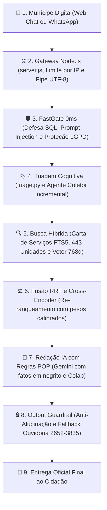

# 🗺 A Jornada da Mensagem no DUQUE IA: Do Clique do Munícipe à Resposta Oficial

---

## 📖 Visão Passo a Passo em Português Brasileiro

> 👤 **Exemplo Real Rastreado:**  
> *"O poste em frente à minha casa no bairro Pilar tá com a lâmpada queimada e a rua tá um breu. Onde ligo ou como peço pra trocarem?"*

---

### As 9 Etapas da Rota:

---

### Detalhamento Completo das 9 Etapas

#### 1. Munícipe Digita (Canais Digitais)
* **O que acontece:** O munícipe digita a pergunta informal no chat web ou WhatsApp. O frontend monta a requisição HTTP POST para o servidor.

#### 2. Gateway Node.js ([server.js](file:///c:/Users/501379.PMDC/Desktop/PRODUCAO/server.js))
* **O que acontece:** Aplica limite de segurança por IP (máximo de 30 mensagens por minuto), valida contra ataques de pastas do sistema (*Path Traversal*) e repassa a mensagem via tubo de comunicação contínuo **Pipe UTF-8** para o Python.

#### 3. FastGate 0ms ([agent/guardrails.py](file:///c:/Users/501379.PMDC/Desktop/PRODUCAO/agent/guardrails.py))
* **O que acontece:** Quatro filtros analisam a pergunta em tempo zero:
  * Injeção SQL (`DROP TABLE`, `SELECT`);
  * Injeção de Prompt / Desvio de Persona;
  * Violação da LGPD (pedir CPF ou processo de vizinhos);
  * Competência (Metrô, INSS e Rodovias Federais são recusados na hora).

#### 4. Triagem Cognitiva ([agent/triage.py](file:///c:/Users/501379.PMDC/Desktop/PRODUCAO/agent/triage.py))
* **O que acontece:** Detecta o que o usuário quer. Se a pergunta for vaga (ex: *"minha rua tá escura"* sem informar onde), ativa o **Agente Coletor**, que faz **apenas uma pergunta por vez** com simpatia para coletar o bairro e o ponto de referência.

#### 5. Busca Híbrida Multimodal ([agent/retrieval.py](file:///c:/Users/501379.PMDC/Desktop/PRODUCAO/agent/retrieval.py))
* **O que acontece:** Busca em 3 fontes simultaneamente:
  * **Carta de Serviços FTS5 ([main.db](file:///c:/Users/501379.PMDC/Desktop/PRODUCAO/data/db/main.db)):** Localiza o serviço oficial de troca de lâmpada em poste.
  * **Entity Resolver GIS ([agent/entity_resolver.py](file:///c:/Users/501379.PMDC/Desktop/PRODUCAO/agent/entity_resolver.py)):** Identifica o bairro **Pilar** e cruza com a base de **443 unidades municipais**.
  * **Vetor Semântico ([vector.db](file:///c:/Users/501379.PMDC/Desktop/PRODUCAO/data/db/vector.db)):** Calcula a similaridade por cosseno com o modelo de 768 dimensões nos 1.575 fragmentos de regras.

#### 6. Fusão RRF e Cross-Encoder ([agent/reranker.py](file:///c:/Users/501379.PMDC/Desktop/PRODUCAO/agent/reranker.py))
* **O que acontece:** Une os resultados de texto exato com a busca semântica e aplica o modelo avaliador profundo:
  $$\text{Nota Final} = 0.60 \times \text{CrossEncoder} + 0.40 \times \text{Score Híbrido}$$
  Elimina qualquer texto irrelevante, deixando apenas o procedimento oficial exato.

#### 7. Redação IA com Regras POP ([agent/handlers.py](file:///c:/Users/501379.PMDC/Desktop/PRODUCAO/agent/handlers.py))
* **O que acontece:** A inteligência artificial redige a resposta seguindo o POP da Prefeitura:
  * Dados factuais destacados em **negrito** (órgão responsável, prazos, contatos).
  * Sem saudações redundantes no meio da conversa.
  * Instrução clara de abertura pelo aplicativo **Colab**.

#### 8. Output Guardrail & Fallback ([agent/guardrails.py](file:///c:/Users/501379.PMDC/Desktop/PRODUCAO/agent/guardrails.py))
* **O que acontece:** Confere se a IA não inventou dados. Se a resposta não tiver respaldo factual no banco, ativa automaticamente o direcionamento oficial para a **Ouvidoria Geral de Duque de Caxias**:
  * Telefone: **(21) 2652-3835**
  * WhatsApp: **(21) 99824-5903**

#### 9. Entrega Oficial Final ao Cidadão ([agent/telemetry.py](file:///c:/Users/501379.PMDC/Desktop/PRODUCAO/agent/telemetry.py))
* **O que acontece:** Registra as métricas de tempo em [telemetry.db](file:///c:/Users/501379.PMDC/Desktop/PRODUCAO/data/db/telemetry.db) e exibe o balão de resposta formatado na tela do munícipe em **menos de 1 segundo**.
