# 🏛 Organograma e Estrutura Hierárquica do DUQUE IA

---

## Estrutura Hierárquica por Módulos

```mermaid
graph TD
    ROOT["DUQUE IA<br/><b>Núcleo Orquestrador Central</b><br/><code>agent/agent.py</code>"]

    %% CAMADA 1
    ROOT --> C1["<b>1. Interface & Gateway</b><br/>Comunicação com o Munícipe"]
    C1 --> C1_1["Web Chat (HTML/JS)"]
    C1 --> C1_2["WhatsApp / Voz WebRTC"]
    C1 --> C1_3["Node.js Server (server.js)<br/>• Rate Limit (30 req/min)<br/>• Anti-Path Traversal"]
    C1 --> C1_4["UTF-8 Pipe Subprocess (agent/main.py)"]

    %% CAMADA 2
    ROOT --> C2["<b>2. Segurança & Triagem</b><br/>Filtros e Tomada de Decisão"]
    C2 --> C2_1["FastGate Guardrails (0ms)<br/>• Anti-SQLi<br/>• Anti-Prompt Injection"]
    C2 --> C2_2["Guardrail LGPD & Competência<br/>• Bloqueio Dados Terceiros<br/>• Bloqueio Âmbito Federal/Estadual"]
    C2 --> C2_3["LangGraph Lite (agent/graph.py)<br/>• Máquina de Estados Resiliente"]
    C2 --> C2_4["Triagem em 3 Níveis (agent/triage.py)<br/>• Nível 1: Regex & Regras<br/>• Nível 2: Cache SQLite<br/>• Nível 3: Classificador LLM"]

    %% CAMADA 3
    ROOT --> C3["<b>3. Agentes & Handlers</b><br/>Especialistas de Resolução"]
    C3 --> C3_1["Agente Coletor (CollectorHandler)<br/>• Coleta Incremental (1 dado por vez)<br/>• Bairro e Ponto de Referência"]
    C3 --> C3_2["Ambiguity Handler<br/>• Clarificação Som Alto (190 vs Colab)"]
    C3 --> C3_3["RAG Handler<br/>• Resolução de Consultas Oficiais"]
    C3 --> C3_4["Security & Conversation Handlers"]

    %% CAMADA 4
    ROOT --> C4["<b>4. Recuperação & Reranking</b><br/>Motor Híbrido de Busca"]
    C4 --> C4_1["FTS5 Relacional (main.db)<br/>• 644 Serviços Municipais"]
    C4 --> C4_2["Busca Vetorial (vector.db)<br/>• 1.575 Chunks (768 dimensões)"]
    C4 --> C4_3["Entity Resolver GIS (agent/entity_resolver.py)<br/>• 443 Unidades Físicas (CRAS/Postos)<br/>• 152 Bairros Municipais"]
    C4 --> C4_4["RRF Fusion & Cross-Encoder<br/>• 60% Cross-Encoder + 40% Híbrido"]

    %% CAMADA 5
    ROOT --> C5["<b>5. Persistência & Observabilidade</b><br/>Armazenamento Desacoplado"]
    C5 --> C5_1["main.db (SQLite WAL)<br/>• Serviços, Secretarias, Unidades"]
    C5 --> C5_2["vector.db (sqlite-vec)<br/>• Embeddings e Índices FTS5"]
    C5 --> C5_3["cache.db (SQLite WAL)<br/>• Cache de Consultas Frequentes"]
    C5 --> C5_4["telemetry.db (SQLite WAL)<br/>• Latência por Nó, Tokens e Custos"]
```

---

## Descrição dos 5 Pilares Estruturais

| Pilar | Responsabilidade Principal | Arquivos e Componentes Chave |
| :--- | :--- | :--- |
| **1. Interface & Gateway** | Receber, autenticar, aplicar rate limit e manter sessões persistentes com o munícipe. | [server.js](file:///c:/Users/501379.PMDC/Desktop/PRODUCAO/server.js), [agent/main.py](file:///c:/Users/501379.PMDC/Desktop/PRODUCAO/agent/main.py), `public/chat.html` |
| **2. Segurança & Triagem** | Interceptar ameaças (0ms), proteger dados conforme a LGPD e rotear a intenção. | [agent/guardrails.py](file:///c:/Users/501379.PMDC/Desktop/PRODUCAO/agent/guardrails.py), [agent/triage.py](file:///c:/Users/501379.PMDC/Desktop/PRODUCAO/agent/triage.py), [agent/graph.py](file:///c:/Users/501379.PMDC/Desktop/PRODUCAO/agent/graph.py) |
| **3. Agentes & Handlers** | Conduzir a lógica conversacional, coletar dados complementares de forma incremental ou preparar o contexto. | [agent/handlers.py](file:///c:/Users/501379.PMDC/Desktop/PRODUCAO/agent/handlers.py), [agent/context_builder.py](file:///c:/Users/501379.PMDC/Desktop/PRODUCAO/agent/context_builder.py) |
| **4. Recuperação & Reranking** | Cruzar palavras-chave exatas, similaridade semântica e localização física municipal. | [agent/retrieval.py](file:///c:/Users/501379.PMDC/Desktop/PRODUCAO/agent/retrieval.py), [agent/reranker.py](file:///c:/Users/501379.PMDC/Desktop/PRODUCAO/agent/reranker.py), [agent/entity_resolver.py](file:///c:/Users/501379.PMDC/Desktop/PRODUCAO/agent/entity_resolver.py) |
| **5. Persistência & Observabilidade** | Micro-bancos desacoplados com concorrência otimizada via modo WAL e telemetria por nó. | [storage/manager.py](file:///c:/Users/501379.PMDC/Desktop/PRODUCAO/storage/manager.py), [agent/telemetry.py](file:///c:/Users/501379.PMDC/Desktop/PRODUCAO/agent/telemetry.py), `data/db/` |
