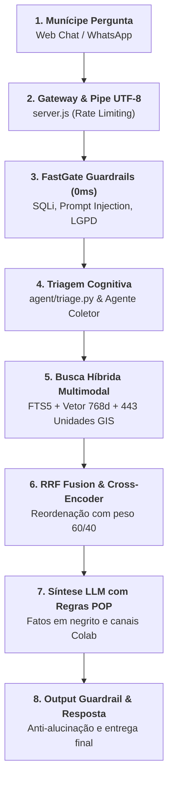

# 🗺 A Jornada da Mensagem no DUQUE IA: Passo a Passo da Entrada à Resposta Oficial

---

## Rastreamento Sequencial da Mensagem

> 📌 **Exemplo Prático Utilizado no Rastreamento:**  
> **Munícipe digita:** *"Onde tem posto de saúde para vacinar meu filho no bairro Pilar?"*

---

### As 8 Estações da Rota:

---

### Detalhamento das Estações

| Estação | Componente / Arquivo | O que acontece | Tempo Estimado |
| :--- | :--- | :--- | :---: |
| **1. Munícipe Pergunta** | `public/chat.html` ou WhatsApp | O cidadão digita a dúvida e envia a requisição HTTP. | — |
| **2. Gateway Node.js** | [server.js](file:///c:/Users/501379.PMDC/Desktop/PRODUCAO/server.js) | Verifica o teto de 30 req/min por IP, cria os IDs de sessão e joga a mensagem no Pipe `stdin` do Python. | `< 1 ms` |
| **3. FastGate Guardrails** | [agent/guardrails.py](file:///c:/Users/501379.PMDC/Desktop/PRODUCAO/agent/guardrails.py) | Avalia em tempo zero se há ataques de injeção, violações da LGPD ou pedidos fora da competência de Duque de Caxias. | `0 ms` |
| **4. Triagem Cognitiva** | [agent/triage.py](file:///c:/Users/501379.PMDC/Desktop/PRODUCAO/agent/triage.py) | Identifica a intenção e verifica se a pergunta já possui bairro e serviço. Se faltar, ativa o **Agente Coletor** (1 pergunta por vez). | `15 - 80 ms` |
| **5. Busca Híbrida** | [agent/retrieval.py](file:///c:/Users/501379.PMDC/Desktop/PRODUCAO/agent/retrieval.py) | Dispara busca em [main.db](file:///c:/Users/501379.PMDC/Desktop/PRODUCAO/data/db/main.db) (Carta de Serviços FTS5 + 443 Unidades de Saúde/CRAS no Pilar) e em [vector.db](file:///c:/Users/501379.PMDC/Desktop/PRODUCAO/data/db/vector.db) (1.575 chunks de normas). | `40 - 110 ms` |
| **6. RRF & Cross-Encoder** | [agent/reranker.py](file:///c:/Users/501379.PMDC/Desktop/PRODUCAO/agent/reranker.py) | Combina palavras exatas e semântica, reordenando com nota calibrada: $0.60 \times \text{CrossEncoder} + 0.40 \times \text{ScoreHíbrido}$. | `30 - 70 ms` |
| **7. Síntese LLM** | [agent/handlers.py](file:///c:/Users/501379.PMDC/Desktop/PRODUCAO/agent/handlers.py) | A LLM gera a resposta oficial respeitando o POP: fatos em **negrito**, sem saudações redundantes e com links do app **Colab**. | `450 - 800 ms` |
| **8. Output Guardrail & Saída** | [agent/guardrails.py](file:///c:/Users/501379.PMDC/Desktop/PRODUCAO/agent/guardrails.py) | Checa se a resposta não inventou dados. Registra a telemetria em [telemetry.db](file:///c:/Users/501379.PMDC/Desktop/PRODUCAO/data/db/telemetry.db) e exibe o texto na tela do munícipe. | `10 - 25 ms` |
