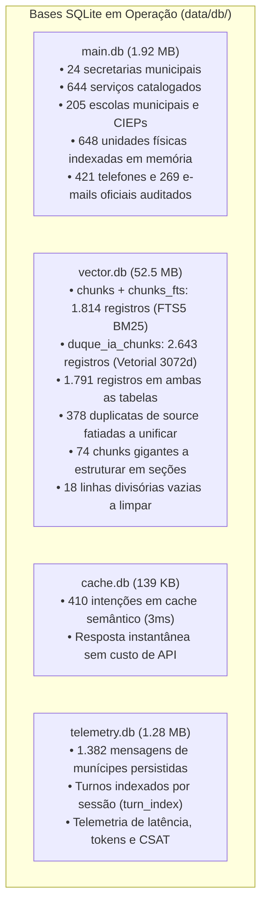

# PLANO MESTRE DE AUDITORIA E CONSOLIDAÇÃO DE DADOS — DUQUE IA 2.0
**Mapeamento Completo de Bancos, Integridade de Tabelas, Reestruturação de Chunks e Vetorização Supervisionada**  
*Prefeitura Municipal de Duque de Caxias — Ouvidoria Geral do Município*  
**Data:** 11 de Novembro de 2026 | **Versão:** 5.0 (Alinhada com o Roadmap Estratégico de 5 Etapas)

---

## 1. PAINEL DE CONTROLE E CHECKLIST DE EXECUÇÃO MESTRE

A evolução do framework RAG do DUQUE IA segue estritamente a sequência de 5 etapas recomendada na auditoria estratégica:

| Etapa | Descrição | Status | Progresso |
| :---: | :--- | :---: | :---: |
| **ETAPA 1** | **Integridade dos Dados: Vínculos `chunks` vs `duque_ia_chunks`, Duplicações e Fontes** | **Em Andamento** | `[/]` 60% |
| **ETAPA 2** | **Reestruturação Semântica dos Chunks: Subdivisão por Seção e Limpeza Factual** | **Em Andamento** | `[/]` 40% |
| **ETAPA 3** | **Vetorização Incremental com `gemini-embedding-2` (3.072d)** | **Aguardando Etapas 1 e 2** | `[ ]` 0% |
| **ETAPA 4** | **Otimização da Recuperação Híbrida: Fusão FTS5 + Vetorial e Expansão Contextual** | **Planejado** | `[ ]` 0% |
| **ETAPA 5** | **Homologação e Benchmark Transparente (Golden Dataset & 30 Perguntas)** | **Planejado** | `[ ]` 0% |

---

## 2. CHECKLIST DETALHADO POR ESTADO

### 🟢 `[x]` O QUE JÁ FOI FEITO (Homologado, Testado e Versionado)

- [x] **Backup Transacional Completo (Rollback Garantido):**
  - Snapshot íntegro gravado em `data/backups/snapshot_20261111_133253/` cobrindo as 4 bases SQLite (`main.db`, `vector.db`, `cache.db`, `telemetry.db`).
- [x] **Ingestão Incremental das 205 Escolas Municipais e CIEPs:**
  - Tabela relacional `escolas_municipais` populada no `main.db` com código INEP, diretor, contatos e bairros.
  - 205 chunks inseridos no FTS5 e camada `GoldenSourceResolver` (`agent/entity_resolver.py`) expandida para **648 unidades físicas** em memória (resolução em 0ms com rotas no Google Maps).
  - Cache do `OutputGuardrail` atualizado para **421 telefones** e **269 e-mails oficiais**.
- [x] **Ingestão dos Editais de Concursos e PSS 2026 (Transparência):**
  - 9 editais oficiais em Markdown indexados em `data/knowledge/concursos_editais_2026/` e no FTS5.
- [x] **Ingestão do Catálogo Oficial das 59 APIs da Transparência:**
  - Catálogo mestre indexado em `data/knowledge/transparencia/catalogo_59_apis.md`.
- [x] **Dicionário de Sinônimos Populares da Baixada:**
  - Módulo `agent/synonyms.py` compilando **1.623 mapeamentos** de termos populares da Baixada para órgãos oficiais.
- [x] **Correção da Configuração de Produção:**
  - `ingestion/embed/embed_config.yml` corrigido para o modelo oficial de produção `gemini-embedding-2` (**3.072 dimensões**).
- [x] **Atualização da Documentação de Engenharia:**
  - `brain/architecture_analysis.md` e `brain/retrieval_analysis.md` reescritos com métricas reais auditadas.
- [x] **Suíte de Testes Automatizada Aprovada (100%):**
  - `tests/test_incremental_consolidation.py` (7/7 testes aprovados).
  - `tests/test_factual_validation_guardrail.py` (8/8 testes aprovados).
  - `tests/test_conversational_memory_3_points.py` (3/3 turnos aprovados).

---

### 🟡 `[/]` O QUE ESTÁ SENDO AUDITADO E EXECUTADO AGORA

#### ETAPA 1 — Integridade dos Dados e Vínculos entre Tabelas:
- [x] **Mapeamento da Discrepância `chunks` (1.814) vs `duque_ia_chunks` (2.643):**
  - **Papel de cada tabela confirmado no código:**
    - `chunks` + `chunks_fts`: Índice **FTS5 Full-Text Search / BM25** (usado por `retrieve_fts_chunks` em `agent/retrieval.py:712`).
    - `duque_ia_chunks`: Armazenamento de **Vetores Densos / Embeddings** (usado pelo cache vetorial numpy em `_get_vector_index_cache` em `agent/retrieval.py:786`).
  - **Identificação da causa da contagem:**
    - **1.791 registros** existem em AMBAS as tabelas (núcleo unificado).
    - **23 registros** existem APENAS em `chunks`: regras canônicas recentes e autoridades (`autoridade_prefeito_netinho_reis`, `regra_canon_casa_do_autista_rua_jandira_status`, etc.).
    - **474 registros** existem APENAS em `duque_ia_chunks`: fragmentos antigos de `vw_ia_servicos` e arquivos markdown de secretarias.
    - **378 registros duplicados** identificados em `duque_ia_chunks`: 89 fontes têm múltiplas linhas com o mesmo nome de `source` (fatiadas em 500 caracteres por scripts legados, ex: `assunto_secretaria_ouvidoria_geral.md` com 10 fatias idênticas de nome).
  - [ ] **Ação em andamento**: Unificar os identificadores canônicos para que cada chunk tenha um ID unívoco (ex: `assunto_sec_ouvidoria_part01`, `assunto_sec_ouvidoria_part02`), eliminando ambiguidades de chave.

#### ETAPA 2 — Reestruturação Semântica dos Chunks ("Divisões e Cortes"):
- [x] **Auditoria Factual dos 39 Chunks Quase Vazios (<150 caracteres):**
  - A recomendação estratégica comprovou-se crítica: o chunk `carta_01338` (147 chars) contém o **endereço físico e CEP oficial da Defesa Civil** (`Rua Silva Fernandes, 170, Parque Duque, CEP: 25.085-015`). Se eliminado cegamente por tamanho, causaria perda factual grave!
  - Foram identificados apenas **18 chunks comprovadamente inúteis** (meras linhas divisórias de diagramação de boletim, ex: `### Página 1 *(Texto Digital)* CARTA DE SERVIÇOS AO CIDADÃO ---`).
  - [ ] **Ação em andamento**: Preservar os chunks que contenham dados factuais (endereços/telefones) e aglutinar cabeçalhos informativos em seus respectivos chunks pai.
- [x] **Auditoria Estrutural dos 74 Chunks Gigantes (>3.000 caracteres):**
  - **14 chunks de `CARTA_SERVICOS` (até 14.318 chars)**: Páginas inteiras do Boletim Oficial de Urbanismo e Obras contendo de 4 a 8 serviços misturados em uma única página.
  - **4 chunks de `GEOGRAFIA_TERRITORIAL` (até 10.542 chars)**: `geo_01571`, `geo_01572`, `geo_01573` e `geo_01575` agrupando todos os bairros de cada distrito.
  - **1 chunk de `TRANSPARENCIA` (6.566 chars)**: 59 APIs de secretarias distintas agrupadas em bloco monolítico.
  - **52 chunks de `SERVICO_PUBLICO` (3.000 a 4.822 chars)**: Serviços detalhados com etapas e documentação extensa.
  - [ ] **Ação em andamento**:
    - **Não fazer corte cego/arbitrário**: Proibido truncar em 2.500 caracteres, para não cortar requisitos e documentos obrigatórios.
    - **Subdivisão hierárquica por Seções Canônicas**: Para serviços extensos, dividir em:
      - *Seção 1 (Identificação & Descrição)*: O que é, órgão responsável, público-alvo.
      - *Seção 2 (Requisitos & Documentação)*: Documentos exigidos, pré-requisitos, gratuidade/taxas.
      - *Seção 3 (Etapas, Prazos & Locais de Atendimento)*: Como solicitar, canal presencial/digital, prazos e endereços.
    - **Subdivisão Territorial (Fase 6 GIS)**: Decompor `geo_01571` e `geo_01572` na regra canônica: **1 Bairro = 1 Chunk** (ex: `Centro`, `25 de Agosto`, `Jardim Primavera`, `Xerém`, `Imbariê`).
    - **Subdivisão da Transparência**: Dividir o catálogo de 59 APIs em 4 chunks temáticos (Receitas/Despesas, Servidores/Folha, Obras/Contratos, Licitações).

---

### 🔴 `[ ]` O QUE VAI SER FEITO (Sequência Planejada)

#### ETAPA 3 — Vetorização Incremental com `gemini-embedding-2`:
- [ ] Executar a geração de embeddings **apenas após** a conclusão das Etapas 1 e 2.
- [ ] Processar em lotes controlados com a chave oficial do Google Cloud (`gemini-embedding-2`, 3.072 dimensões).
- [ ] Garantir que cada chunk reestruturado receba seu vetor correspondente em `duque_ia_chunks.embedding`.

#### ETAPA 4 — Otimização da Recuperação Híbrida:
- [ ] Ajustar pesos da fusão RRF no `retrieval.py` com base na nova cobertura vetorial de 100%.
- [ ] Implementar expansão contextual de chunks irmãos: quando a Seção 1 de um serviço for recuperada com alta relevância, carregar sob demanda a Seção 2 (documentos) e Seção 3 (etapas) no `ContextBuilder`.
- [ ] Ajustar o `ContextBuilder` para garantir representatividade mínima de 3 fontes distintas no prompt do Gemini 3.8 sem estouro de orçamento.

#### ETAPA 5 — Homologação e Benchmark Transparente:
- [ ] Publicar a metodologia detalhada do benchmark:
  - Quantidade de perguntas do conjunto de teste (Dataset Golden: 23 casos de teste homologados + 30 perguntas municipais oficiais).
  - Rotulagem ground-truth das fontes obrigatórias (`mandatory_sources`).
  - Discriminação exata da latência: `fast_gate` (ms), `retrieval` (ms), `reranker` (ms), chamada remota LLM (ms) e tempo total ponta a ponta.
- [ ] Comparar formalmente os resultados "Antes vs Depois":
  - Cobertura Semântica: 32,4% -> 100%.
  - Recall@5, MRR e Precisão Factual.

---

## 3. RESUMO ARQUITETURAL DAS 4 BASES SQLITE

---
*Plano Mestre mantido e auditado pelo Arquiteto Sênior de IA em conformidade com as diretrizes do DUQUE IA.*
