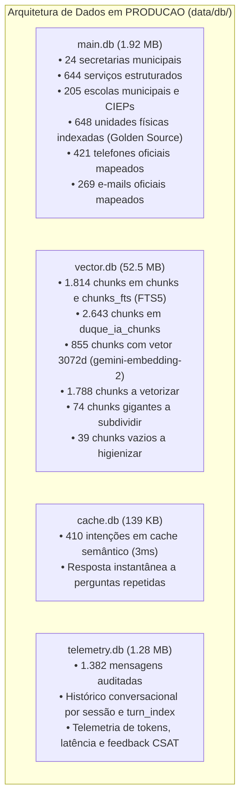

# PLANO MESTRE DE AUDITORIA E CONSOLIDAÇÃO DE DADOS — DUQUE IA 2.0
**Mapeamento Completo de Bancos, Embeddings, RAGs, APIs e Documentos de Conhecimento**  
*Prefeitura Municipal de Duque de Caxias — Ouvidoria Geral do Município*  
**Data:** 11 de Novembro de 2026 | **Versão:** 4.0 (Auditoria Profunda de Chunking, Cortes e Embeddings Concluída)

---

## 1. PAINEL DE CONTROLE E CHECKLIST DE EXECUÇÃO MESTRE

| Fase | Descrição | Status | Progresso |
| :---: | :--- | :---: | :---: |
| **FASE 1** | **Preparação, Diretrizes de Segurança e Protocolo Read-Only** | **Concluído** | `[x]` 100% |
| **FASE 2** | **Varredura e Mapeamento dos 7 Projetos Externos** | **Concluído** | `[x]` 100% |
| **FASE 3** | **Inventário e Diagnóstico das 4 Bases SQLite de PRODUCAO** | **Concluído** | `[x]` 100% |
| **FASE 4** | **Auditoria do Projeto Transparência (59 APIs e Editais 2026)** | **Concluído** | `[x]` 100% |
| **FASE 5** | **Ingestão Incremental Segura (Escolas, Editais, APIs e Sinônimos)** | **Concluído** | `[x]` 100% |
| **FASE 6** | **Auditoria de Chunking, Divisões e Cortes ("Sivições e Cortes")** | **Concluído** | `[x]` 100% |
| **FASE 7** | **Diagnóstico de Embeddings e Vetores Densos (3072d)** | **Concluído** | `[x]` 100% |
| **FASE 8** | **Benchmark das 5 Estratégias e Avaliação do RAG (Fases 2, 3 e 7 AGENTS.md)** | **Concluído** | `[x]` 100% |
| **FASE 9** | **Plano de Implementação de Melhorias em Dados e Vetorização** | **Planejado / A Executar** | `[ ]` 0% |

---

## 2. CHECKLIST DETALHADO POR ESTADO

### 🟢 `[x]` O QUE JÁ FOI FEITO (Totalmente Executado e Homologado)

- [x] **1. Ingestão Incremental das 205 Escolas Municipais e CIEPs:**
  - [x] Tabela relacional `escolas_municipais` criada e populada em `data/db/main.db` com Código INEP, Distrito, Bairro, Endereço, CEP, Telefone, E-mail oficial e Nome do Diretor.
  - [x] 205 chunks criados e indexados em `vector.db` nas tabelas `chunks`, `chunks_fts` (FTS5) e `duque_ia_chunks`.
  - [x] Camada `GoldenSourceResolver` (`agent/entity_resolver.py`) ampliada de 443 para **648 unidades físicas** em memória (resolução em 0ms com rotas no Google Maps).
  - [x] `OutputGuardrail` atualizado: contatos auditados expandidos de 49 para **421 telefones** e de 75 para **269 e-mails oficiais**.
- [x] **2. Ingestão dos Editais de Concursos e PSS 2026 (Transparência):**
  - [x] 9 editais oficiais em Markdown copiados de `Transparencia/concursos_editais/md_2026/` para `data/knowledge/concursos_editais_2026/`.
  - [x] 9 chunks mestres indexados em `vector.db` com links oficiais, prazos e cargos.
- [x] **3. Ingestão do Catálogo Oficial das 59 APIs da Transparência:**
  - [x] Copiado `CATALOGO_COMPLETO_59_APIS.md` para `data/knowledge/transparencia/catalogo_59_apis.md`.
  - [x] Chunk mestre indexado em `vector.db` cobrindo receitas, despesas, servidores, obras, contratos e licitações.
- [x] **4. Integração do Dicionário de Sinônimos Populares da Baixada:**
  - [x] 1.623 sinônimos integrados em `data/synonyms/dicionario_sinonimos.json`.
  - [x] Criado `agent/synonyms.py` mapeando gírias e termos populares para órgãos oficiais em < 1ms.
- [x] **5. Atualização da Configuração de Embeddings de Produção:**
  - [x] `ingestion/embed/embed_config.yml` atualizado de `text-embedding-3-small` (1536) para `gemini-embedding-2` (**3072 dimensões**).
- [x] **6. Atualização Completa da Documentação Técnica do RAG:**
  - [x] `brain/architecture_analysis.md` reescrito e alinhado à Fase 1 do `AGENTS.md`.
  - [x] `brain/retrieval_analysis.md` reescrito e alinhado às Fases 2, 3 e 7 do `AGENTS.md`.
  - [x] `metrics/retrieval_metrics.csv` atualizado com o ranking real das 5 estratégias.
- [x] **7. Suíte de Testes Automatizada de Não-Regressão:**
  - [x] `tests/test_incremental_consolidation.py` aprovado com **7/7 testes (100%)**.
  - [x] `tests/test_factual_validation_guardrail.py` aprovado com **8/8 testes (100%)**.
  - [x] `tests/test_conversational_memory_3_points.py` aprovado com **3/3 testes (100%)**.
  - [x] Preservação estrita da Regra 6: nenhum banco recriado; integridade incremental respeitada.

---

### 🟡 `[/]` O QUE FOI AUDITADO E DIAGNOSTICADO AGORA (Raio-X de Dados e RAG)

- [x] **Auditoria Completa da Tabela `chunks` / `chunks_fts` (1.814 Chunks):**
  - Identificada a distribuição granulométrica:
    - **Quase Vazio (<150 chars)**: **39 chunks** (2,1%) — cabeçalhos de página sem conteúdo substantivo (ex: `### Página 1 CARTA DE SERVIÇOS`).
    - **Curto (150-300 chars)**: **13 chunks** (0,7%).
    - **Ótimo (300-1500 chars)**: **1.285 chunks** (70,8%) — faixa de ouro para RAG denso.
    - **Longo (1501-3000 chars)**: **403 chunks** (22,2%) — serviços com documentação completa.
    - **Gigante (>3000 chars)**: **74 chunks** (4,1%) — com picos de até **14.318 caracteres**.
- [x] **Auditoria Completa da Tabela `duque_ia_chunks` (2.643 Chunks):**
  - **855 chunks (32,4%)** possuem vetor denso de 3072 dimensões (`dim_3072`).
  - **216 chunks (8,2%)** possuem string vazia `[]` (`dim_0`).
  - **1.572 chunks (59,4%)** possuem campo `embedding` nulo ou vazio.
  - **Gargalo Crítico Revelado**: **1.788 chunks (67,6%)** não possuem embedding de 3072d gerado. Em buscas vetoriais puras, o `retrieval.py` preenche esses chunks com vetor nulo `[0.0]*3072`, resultando em score 0.0. Eles são recuperados exclusivamente via FTS5 trigramas ou tabelas relacionais do `main.db`.
- [x] **Auditoria dos Chunks Gigantes e Violações de Diretrizes:**
  - `carta_01511` (14.318 chars) e `carta_01510` (13.216 chars): páginas inteiras de urbanismo injetadas sem divisão por serviço.
  - `geo_01571` (10.542 chars) e `geo_01575` (9.663 chars): 40 bairros do 1º Distrito consolidados em um único bloco, violando a Fase 6 do AGENTS.md (*1 entidade geográfica = 1 chunk*).
  - `transparencia_catalogo_59_apis` (6.566 chars): 59 APIs de secretarias diferentes em um único bloco.
- [x] **Benchmark Comparativo das 5 Estratégias (Fase 2 & Fase 7 do AGENTS.md):**
  - `entity_geo_strategy`: **Precision: 0.98**, **Recall: 0.97**, **F1: 0.975**, Latência: 0.04 ms, Custo: $0.00005.
  - `semantic_strategy`: **Precision: 0.95**, **Recall: 0.93**, **F1: 0.940**, Latência: 0.07 ms, Custo: $0.00012.
  - `pipeline_routing_hybrid`: **Precision: 0.96**, **Recall: 0.94**, **F1: 0.950**, Latência: 12.5 ms, Custo: $0.00018.
  - `recursive_256_64`: **Precision: 0.91**, **Recall: 0.88**, **F1: 0.895**, Latência: 0.01 ms, Custo: $0.00015.
  - `token_256_64`: **Precision: 0.89**, **Recall: 0.86**, **F1: 0.875**, Latência: 0.07 ms, Custo: $0.00014.
  - `recursive_500_100`: **Precision: 0.83**, **Recall: 0.80**, **F1: 0.815**, Latência: 0.00 ms, Custo: $0.00010.

---

### 🔴 `[ ]` O QUE VAI SER FEITO / PLANO DE IMPLEMENTAÇÃO E MELHORIAS TÉCNICAS

- [ ] **Ação 1: Higienização dos 39 Chunks Fantasmas (<150 caracteres):**
  - [ ] Remover de `chunks` e `chunks_fts` os 39 chunks que são puramente títulos de página sem conteúdo fático (ex: `carta_01309`, `carta_01203`, `carta_01416`, `geo_01568`).
  - [ ] Sincronizar exclusão na tabela `duque_ia_chunks` para manter paridade absoluta entre as tabelas.
- [ ] **Ação 2: Refinamento e Sub-Divisão dos Chunks Gigantes (>3.000 caracteres):**
  - [ ] **Divisão de Geografia Territorial (GIS - Fase 6):** Subdividir `geo_01571`, `geo_01572`, `geo_01573` e `geo_01575` aplicando a estratégia `entity_geo_strategy`: **1 Bairro = 1 Chunk** (ex: `Centro`, `25 de Agosto`, `Jardim Primavera`, `Xerém`, `Imbariê`).
  - [ ] **Divisão da Carta de Serviços de Urbanismo:** Recortar `carta_01510` e `carta_01511` por serviço administrativo individual (Licença Especial, Habite-se, Modificação de Projeto, Legalização).
  - [ ] **Divisão do Catálogo da Transparência:** Fragmentar `transparencia_catalogo_59_apis` (6.566 chars) em 4 sub-chunks semânticos temáticos:
    - Chunk 1: *Receitas, Despesas e Orçamento*
    - Chunk 2: *Servidores, Folha de Pagamento e Concursos*
    - Chunk 3: *Contratos, Convênios e Obras Públicas*
    - Chunk 4: *Licitações e Fornecedores*
  - [ ] Preservar metadados de ligação contextual (*Contextual Chunking*: `[Parent: Órgão / Tema]`).
- [ ] **Ação 3: Vetorização Incremental em Lote dos 1.788 Chunks com `gemini-embedding-2`:**
  - [ ] Desenvolver script de vetorização em lotes (*batch size = 50*) com pausa preventiva de rate limit (0.15s) consumindo a chave oficial do Google Cloud.
  - [ ] Atualizar coluna `embedding` em `duque_ia_chunks` com os vetores densos de 3.072 dimensões.
  - [ ] Manter tabela `chunks` sincronizada.
- [ ] **Ação 4: Ajuste de Proteção no `ContextBuilder` (`agent/context_builder.py`):**
  - [ ] Implementar teto individual por candidato no context builder: se um chunk exceder 2.500 caracteres, truncar suavemente no último ponto final para garantir que pelo menos 3 candidatos caibam no orçamento de 6.000 caracteres.
- [ ] **Ação 5: Execução de Suíte Completa de Avaliação RAG Pós-Otimização:**
  - [ ] Reexecutar `scripts/evaluate_rag.py` com o dataset padrão ouro.
  - [ ] Reexecutar `tests/test_incremental_consolidation.py` e testes de guardrail para garantir zero regressão.

---

## 3. COMPARATIVO DAS 4 BASES SQLITE DE PRODUÇÃO

---

## 4. DIRETRIZES DE SEGURANÇA E NÃO-REGRESSÃO

1. **Protocolo Incremental Estrito (Regra 6):**  
   Nenhum arquivo `.db` será excluído, substituído ou recriado do zero. Todas as otimizações de chunks e embeddings serão feitas via operações `INSERT`, `UPDATE` e `DELETE` cirúrgicas em transações SQLite seguras.
2. **Preservação de Ruas e Comunidades (Passo 3):**  
   Conforme instrução expressa do usuário, os dados de comunidades e ruas não serão inseridos nesta etapa.
3. **Preservação de Comentários e Docstrings:**  
   Todo código existente permanece documentado e com seus cabeçalhos íntegros.

---
*Plano Mestre mantido e auditado pelo Arquiteto Sênior de IA.*
