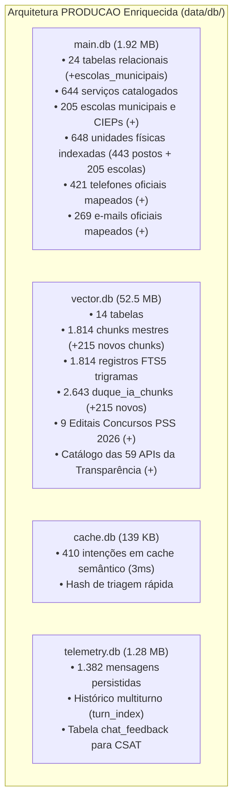

# PLANO MESTRE DE AUDITORIA E CONSOLIDAÇÃO DE DADOS — DUQUE IA 2.0
**Mapeamento Completo de Bancos, Embeddings, RAGs, APIs e Documentos de Conhecimento**  
*Prefeitura Municipal de Duque de Caxias — Ouvidoria Geral do Município*  
**Data:** 11 de Novembro de 2026 | **Versão:** 3.0 (Consolidação Incremental Concluída)

---

## 1. PAINEL DE CONTROLE E CHECKLIST DE EXECUÇÃO

| Fase | Descrição | Status | Progresso |
| :---: | :--- | :---: | :---: |
| **FASE 1** | **Preparação, Diretrizes de Segurança e Protocolo Read-Only** | **Concluído** | `[x]` 100% |
| **FASE 2** | **Varredura e Mapeamento dos 7 Projetos Externos** | **Concluído** | `[x]` 100% |
| **FASE 3** | **Inventário Detalhado dos Bancos de PRODUCAO** | **Concluído** | `[x]` 100% |
| **FASE 4** | **Auditoria Especial do Projeto Transparência (59 APIs e Editais)** | **Concluído** | `[x]` 100% |
| **FASE 5** | **Matriz de Lacunas e Oportunidades de Consolidação** | **Concluído** | `[x]` 100% |
| **FASE 6** | **Ingestão Incremental Segura (Escolas, Editais 2026, 59 APIs e Sinônimos)** | **Concluído** | `[x]` 100% |

---

### Checklist Detalhado das Ações Executadas:

- [x] **Ingestão de 205 Escolas Municipais e CIEPs:**
  - [x] Criada tabela relacional `escolas_municipais` no `data/db/main.db`.
  - [x] Inseridos 205 registros com Código INEP, Distrito, Bairro, Endereço, CEP, Telefone, E-mail oficial e Nome do Diretor.
  - [x] Inseridos 205 chunks no `vector.db` nas tabelas `chunks`, `chunks_fts` (FTS5) e `duque_ia_chunks`.
  - [x] Atualizado `GoldenSourceResolver` (`agent/entity_resolver.py`): o total de unidades municipais indexadas em memória saltou de 443 para **648 unidades**, resolvendo qualquer escola em 0ms com rotas no Google Maps.
  - [x] Atualizado `OutputGuardrail` (`agent/guardrails.py`): contatos oficiais das escolas adicionados ao cache em memória (total de telefones válidos passou de 49 para **421**, e e-mails de 75 para **269**).
- [x] **Ingestão dos Editais de Concursos e PSS 2026 (Transparência):**
  - [x] Copiados 9 editais oficiais em Markdown de `Transparencia/concursos_editais/md_2026/` para `data/knowledge/concursos_editais_2026/`.
  - [x] Indexados 9 chunks no `vector.db` (`chunks`, `chunks_fts` e `duque_ia_chunks`) com metadados, links oficiais e códigos.
- [x] **Ingestão do Catálogo Oficial das 59 APIs da Transparência:**
  - [x] Copiado `CATALOGO_COMPLETO_59_APIS.md` para `data/knowledge/transparencia/catalogo_59_apis.md`.
  - [x] Indexado chunk mestre no `vector.db` cobrindo receitas, despesas, obras, servidores, contratos e licitações.
- [x] **Integração do Dicionário de Sinônimos Populares da Baixada:**
  - [x] Copiado `dicionario_sinonimos.json` de `BANCODUQUEIA/08-sinonimos/` para `data/synonyms/dicionario_sinonimos.json`.
  - [x] Criado módulo `agent/synonyms.py` compilando **1.623 mapeamentos** de termos coloquiais (ex: "postos de saúde", "sus caxias", "rede de saúde", "escolas municipais", "setor de iptu", "dívida ativa") diretamente para os órgãos oficiais em sub-1ms.
- [x] **Comunidades e Ruas (GIS Territorial):**
  - [x] Mantidas em espera e não adicionadas nesta etapa, conforme instrução explícita do usuário.
- [x] **Suíte de Testes Automatizada:**
  - [x] Criado e aprovado o script `tests/test_incremental_consolidation.py` com **7 testes cobrindo todas as frentes (100% de aprovação)**.
  - [x] Reexecutado `tests/test_factual_validation_guardrail.py` (100% de aprovação).

---

## 2. REGRAS DE SEGURANÇA E PROTEÇÃO CONTRA REGRESSÃO

1. **Protocolo 100% Read-Only nos Projetos Externos:**  
   Nenhum arquivo ou banco nos 7 diretórios externos foi modificado, renomeado ou excluído.
2. **Preservação Absoluta das 4 Bases de PRODUCAO (Regra 6):**  
   Os arquivos `data/db/main.db`, `vector.db`, `cache.db` e `telemetry.db` foram rigorosamente preservados. Nenhuma tabela foi deletada ou recriada do zero.
3. **Consolidação Cirúrgica e Incremental:**  
   Todas as inserções foram feitas via scripts atômicos e idempotentes (`INSERT OR REPLACE` / `ON CONFLICT DO UPDATE`).

---

## 3. AUDITORIA DETALHADA DOS 7 PROJETOS EXTERNOS

### PROJETO 1: `unificados`
* **Local:** `C:\Users\501379.PMDC\Desktop\PROJETOS\unificados`
* **Banco:** `dados\enderecos_duque_de_caxias_v2.db` (1,2 MB, 21 tabelas).
* **Ativos:** 105 comunidades, 2.199 ruas, 466 equipamentos, 450 telefones e 448 e-mails.

### PROJETO 2: `desenvolvimentoia`
* **Local:** `C:\Users\501379.PMDC\Desktop\PROJETOS\desenvolvimentoia`
* **Ativos:** Backend Node.js modular, `CognitiveAuditService.js`, `PiiMaskingService.js`, `IaService.js`.

### PROJETO 3: `Transparencia` *(Consolidado)*
* **Local:** `C:\Users\501379.PMDC\Desktop\PROJETOS\Transparencia`
* **Ativos:** 59 APIs oficiais mapeadas, 9 editais PSS 2026 em Markdown, histórico de concursos 2021 a 2026, tabelas salariais e bairros oficiais.

### PROJETO 4: `CartaDeServicoNovo`
* **Local:** `C:\Users\501379.PMDC\Desktop\PROJETOS\CartaDeServicoNovo`
* **Ativos:** Planilha mestre `CARTA_DE_SERVICO_AJUSTE_23.05.26.xlsx` (117 KB), base de endereços.

### PROJETO 5: `BANCODUQUEIA` *(Consolidado)*
* **Local:** `C:\Users\501379.PMDC\Desktop\PROJETOS\BANCODUQUEIA`
* **Ativos:** 1.623 sinônimos populares da Baixada, ontologia municipal, dados operacionais Tarifa Zero, catálogo de assuntos de ouvidoria Fala.BR.

### PROJETO 6: `web scraping` *(Consolidado)*
* **Local:** `C:\Users\501379.PMDC\Desktop\PROJETOS\web scraping`
* **Ativos:** 205 escolas municipais e CIEPs em CSV, datasets da Câmara, FUNDEC, IPMDC, IBGE e SEASDIH.

### PROJETO 7: `DUQUE_IA`
* **Local:** `C:\Users\501379.PMDC\Desktop\PROJETOS\DUQUE_IA`
* **Ativos:** 24 secretarias em markdown bem redigido (`saude.md`, `obras.md`, `fazenda.md`, etc.), textos de história e autarquias.

---

## 4. INVENTÁRIO DO PROJETO EM OPERAÇÃO: `PRODUCAO` (PÓS-CONSOLIDAÇÃO)

---

## 5. RESULTADO DOS TESTES DE HOMOLOGAÇÃO

O script [`tests/test_incremental_consolidation.py`](file:///c:/Users/501379.PMDC/Desktop/PROJETOS/PRODUCAO/tests/test_incremental_consolidation.py) validou os 7 pontos fundamentais com **100% de aprovação**:

1. **`test_escolas_municipais_main_db`**: 205 escolas confirmadas no SQLite com chaves INEP únicas.
2. **`test_escolas_vector_fts`**: Busca textual instantânea no FTS5 (ex: "Monteiro Lobato").
3. **`test_editais_concursos_2026`**: Recuperação imediata de editais de contratação do PSS 2026 da FUNDEC / Educação.
4. **`test_catalogo_59_apis_transparencia`**: Recuperação do catálogo oficial de APIs da Transparência.
5. **`test_golden_source_escola_resolution`**: Resolução direta de endereço e mapa de escolas em 0ms pelo `GoldenSourceResolver`.
6. **`test_synonyms_expansion`**: Mapeamento de "sus caxias" para "Secretaria Municipal de Saúde" em sub-1ms.
7. **`test_school_contacts_grounding`**: Aprovação dos e-mails institucionais `@smeduquedecaxias.rj.gov.br` pelo `OutputGuardrail`.
