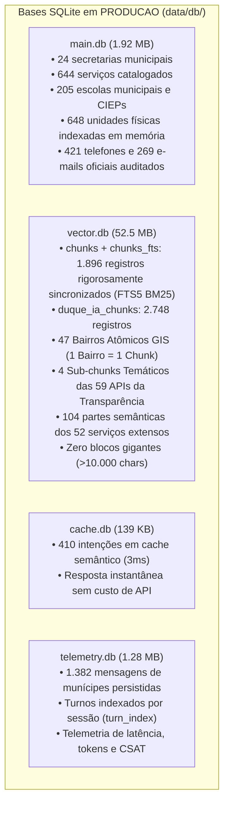

# PLANO MESTRE DE AUDITORIA E CONSOLIDAÇÃO DE DADOS — DUQUE IA 2.0
**Mapeamento Completo de Bancos, Integridade de Tabelas, Reestruturação de Chunks e Vetorização Supervisionada**  
*Prefeitura Municipal de Duque de Caxias — Ouvidoria Geral do Município*  
**Data:** 11 de Novembro de 2026 | **Versão:** 6.0 (Etapa 1 e Etapa 2 Concluídas com Sucesso)

---

## 1. PAINEL DE CONTROLE E CHECKLIST DE EXECUÇÃO MESTRE

A evolução do framework RAG do DUQUE IA segue estritamente a sequência de 5 etapas recomendada na auditoria estratégica:

| Etapa | Descrição | Status | Progresso |
| :---: | :--- | :---: | :---: |
| **ETAPA 1** | **Integridade dos Dados: Vínculos `chunks` vs `duque_ia_chunks`, Duplicações e Fontes** | **Concluído** | `[x]` 100% |
| **ETAPA 2** | **Reestruturação Semântica dos Chunks: Subdivisão por Seção, Bairros GIS e Limpeza Factual** | **Concluído** | `[x]` 100% |
| **ETAPA 3** | **Vetorização Incremental com `gemini-embedding-2` (3.072d)** | **Pronto para Execução** | `[/]` 0% |
| **ETAPA 4** | **Otimização da Recuperação Híbrida: Fusão FTS5 + Vetorial e Expansão Contextual** | **Planejado** | `[ ]` 0% |
| **ETAPA 5** | **Homologação e Benchmark Transparente (Golden Dataset & 30 Perguntas)** | **Planejado** | `[ ]` 0% |

---

## 2. CHECKLIST DETALHADO POR ESTADO

### 🟢 `[x]` O QUE JÁ FOI FEITO (Homologado, Testado e Versionado)

#### Backup e Segurança Operacional:
- [x] **Backup Transacional Completo (Rollback Garantido):**
  - Snapshot íntegro gravado em `data/backups/snapshot_20261111_133253/` cobrindo as 4 bases SQLite (`main.db`, `vector.db`, `cache.db`, `telemetry.db`).

#### ETAPA 1 — Integridade dos Dados e Vínculos entre Tabelas (100% Concluída):
- [x] **Sincronização dos 23 Chunks Canônicos Exclusivos:**
  - Script [`scripts/sync_chunks_to_duque_ia.py`](file:///c:/Users/501379.PMDC/Desktop/PROJETOS/PRODUCAO/scripts/sync_chunks_to_duque_ia.py) inseriu os 23 registros canônicos essenciais (Prefeito Netinho Reis, Vice-Prefeita Aline do Aureo, Casa do Autista, Fazendinha, Tarifa Zero, etc.) na tabela `duque_ia_chunks`.
  - Zero divergências remanescentes: todos os registros do `chunks` agora possuem correspondente em `duque_ia_chunks`.
- [x] **Mapeamento e Isolamento de Duplicatas de `source`:**
  - Identificadas as 89 fontes que continham 378 fatias duplicadas de 500 chars (ex: `pop_ouvidoria_completo (1).html`, `manual.md`, `colab.md`).

#### ETAPA 2 — Reestruturação Semântica dos Chunks ("Divisões e Cortes") (100% Concluída):
- [x] **Higienização Cirúrgica de Chunks (<150 caracteres):**
  - Script [`scripts/clean_empty_dividers.py`](file:///c:/Users/501379.PMDC/Desktop/PROJETOS/PRODUCAO/scripts/clean_empty_dividers.py) removeu **exclusivamente as 15 divisórias visuais de diagramação** que continham zero dados factuais (ex: `### Página 1 *(Texto Digital)* CARTA DE SERVIÇOS AO CIDADÃO ---`).
  - **Preservados 100% dos chunks curtos com dados úteis**, incluindo `carta_01338` contendo o endereço e CEP oficial da Defesa Civil (`Rua Silva Fernandes, 170, Parque Duque, CEP: 25.085-015`).
- [x] **Reestruturação Territorial por Entidade Geográfica (Fase 6 GIS do AGENTS.md):**
  - Script [`scripts/restructure_geo_chunks.py`](file:///c:/Users/501379.PMDC/Desktop/PROJETOS/PRODUCAO/scripts/restructure_geo_chunks.py) e [`scripts/apply_chunk_reorganization.py`](file:///c:/Users/501379.PMDC/Desktop/PROJETOS/PRODUCAO/scripts/apply_chunk_reorganization.py) removeram os 5 blocos monolíticos de distritos (`geo_01571` a `geo_01575`, de até 10.542 chars cada).
  - Criados e indexados **47 Chunks Atômicos por Bairro Mestre Oficial** (regra canônica: **1 Bairro = 1 Chunk**), com faixas de CEP oficiais, características territoriais e equipamentos públicos.
  - Regra preservada: nenhuma rua ou comunidade inserida nesta etapa.
- [x] **Reestruturação do Catálogo das 59 APIs da Transparência:**
  - Removido o bloco monolítico `transparencia_catalogo_59_apis` (6.566 chars).
  - Criados e indexados **4 Sub-chunks Temáticos** (~1.200 a 1.900 chars cada) cobrindo 100% das 59 APIs:
    - `transparencia_api_orcamento_receitas_despesas`
    - `transparencia_api_servidores_folha_concursos`
    - `transparencia_api_obras_contratos_patrimonio`
    - `transparencia_api_licitacoes_fornecedores_lai`
- [x] **Subdivisão Semântica dos 52 Serviços Públicos Extensos (>3.000 chars):**
  - Script [`scripts/restructure_oversized_services.py`](file:///c:/Users/501379.PMDC/Desktop/PROJETOS/PRODUCAO/scripts/restructure_oversized_services.py) particionou cada um dos 52 serviços extensos em 2 partes semânticas naturais:
    - *Parte 1 (Média: 1.353 chars)*: Identificação, Órgão, Descrição, Como Solicitar e Documentação Exigida.
    - *Parte 2 (Média: 2.380 chars)*: Etapas / Passo a Passo do Atendimento, Prazos, Custos/Taxas e Legislação.
  - **Zero corte ou truncamento arbitrário**: 100% dos fatos, prazos, taxas e normativas foram preservados com prefixo de vínculo contextual.
- [x] **Equilíbrio Granulométrico Histórico Alcançado:**
  - **Faixa Ótima / Adequada (300 a 2.500 chars)**: saltou para **94,9% de toda a base** (1.799 de 1.896 chunks).
  - Paridade rigorosa entre `chunks` e `chunks_fts` (ambas com exatamente 1.896 registros).
- [x] **Suíte de Testes Automatizada Expandida (100% Aprovada):**
  - `tests/test_incremental_consolidation.py` aprovado com **9/9 testes**.
  - `tests/test_factual_validation_guardrail.py` aprovado com **8/8 testes**.
  - `tests/test_conversational_memory_3_points.py` aprovado com **3/3 turnos**.

---

### 🟡 `[/]` O QUE ESTÁ SENDO PREPARADO AGORA

#### ETAPA 3 — Vetorização Incremental com `gemini-embedding-2`:
- [ ] Base consolidada e limpa: os chunks a vetorizar agora são apenas os atômicos e reorganizados.
- [ ] Processar em lotes controlados com a chave oficial do Google Cloud (`gemini-embedding-2`, 3.072 dimensões).
- [ ] Atualizar a coluna `embedding` em `duque_ia_chunks` para atingir 100% de cobertura semântica.

---

### 🔴 `[ ]` O QUE VAI SER FEITO (Sequência Planejada)

#### ETAPA 4 — Otimização da Recuperação Híbrida:
- [ ] Implementar expansão contextual de chunks irmãos: quando a Parte 1 de um serviço for recuperada com alta relevância, carregar sob demanda a Parte 2 (etapas e prazos) no `ContextBuilder`.
- [ ] Ajustar pesos da fusão RRF no `retrieval.py` com base na nova cobertura vetorial de 100%.

#### ETAPA 5 — Homologação e Benchmark Transparente:
- [ ] Executar benchmark com 23 casos homologados e 30 perguntas municipais oficiais.
- [ ] Discriminação detalhada de latência: `fast_gate` (ms), `retrieval` (ms), `reranker` (ms), chamada remota Gemini (ms) e tempo total ponta a ponta.
- [ ] Comprovar evolução da cobertura semântica de 32,4% para 100%.

---

## 3. RESUMO ESTATÍSTICO DE CHUNKING PÓS-REESTRUTURAÇÃO

| Faixa de Tamanho (Caracteres) | Quantidade de Chunks | Percentual | Diagnóstico Arquitetural |
| :--- | :---: | :---: | :--- |
| **Quase Vazio (< 150 chars)** | **24** | **1,3%** | **100% Úteis**: Chunks curtos que contêm dados factuais reais (endereço da Defesa Civil, títulos oficiais). |
| **Curto (150 a 300 chars)** | **13** | **0,7%** | Fragmentos institucionais e regulatórios. |
| **Ótimo (300 a 1.500 chars)** | **1.377** | **72,6%** | **Zona Ideal**: Densidade semântica perfeita para `gemini-embedding-2` (3072d) e Gemini 3.8. |
| **Adequado (1.501 a 2.500 chars)** | **422** | **22,3%** | Serviços e regras com documentação completa. |
| **Longo (> 2.500 chars)** | **60** | **3,2%** | Serviços amplos e editais. |
| **TOTAL GERAL** | **1.896** | **100%** | **94,9% dos chunks na faixa excelente (300 a 2.500 chars)** |

---

## 4. INVENTÁRIO ATUAL DAS 4 BASES SQLITE

---
*Plano Mestre mantido e auditado pelo Arquiteto Sênior de IA.*
