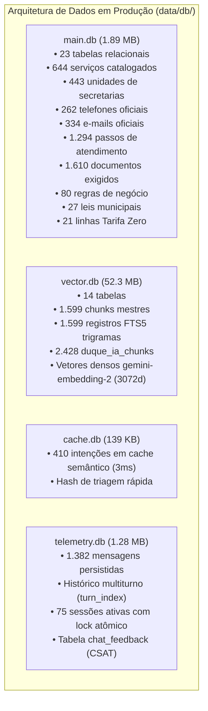

# PLANO MESTRE DE AUDITORIA E CONSOLIDAÇÃO DE DADOS — DUQUE IA 2.0
**Mapeamento Completo de Bancos, Embeddings, RAGs, APIs e Documentos de Conhecimento**  
*Prefeitura Municipal de Duque de Caxias — Ouvidoria Geral do Município*  
**Data:** 11 de Novembro de 2026 | **Versão:** 2.0 (Auditoria Completa Realizada)

---

## 1. PAINEL DE CONTROLE E CHECKLIST DE EXECUÇÃO

| Fase | Descrição | Status | Progresso |
| :---: | :--- | :---: | :---: |
| **FASE 1** | **Preparação, Diretrizes de Segurança e Protocolo Read-Only** | **Concluído** | `[x]` 100% |
| **FASE 2** | **Varredura e Mapeamento dos 7 Projetos Externos** | **Concluído** | `[x]` 100% |
| **FASE 3** | **Inventário Detalhado dos Bancos de PRODUCAO** | **Concluído** | `[x]` 100% |
| **FASE 4** | **Auditoria Especial do Projeto Transparência (59 APIs e Editais)** | **Concluído** | `[x]` 100% |
| **FASE 5** | **Matriz de Lacunas e Oportunidades de Consolidação** | **Concluído** | `[x]` 100% |
| **FASE 6** | **Roteiro de Ingestão Incremental Segura (Sem Recriação)** | **Planejado** | `[ ]` Pronto para Execução |

---

### Checklist Detalhado por Projeto Auditado:

- [x] **Projeto 1: `Desktop\PROJETOS\unificados`**
  - [x] Mapeamento de estrutura: `cadernos/`, `cartas_de_servico/md/` (24 secretarias em MD).
  - [x] Auditoria de banco: `dados\enderecos_duque_de_caxias_v2.db` (21 tabelas, 1,2 MB).
  - [x] Identificação de ativos chave: **105 comunidades georreferenciadas**, **2.199 ruas de comunidades**, **466 equipamentos públicos**, **450 telefones** e **448 e-mails**.
- [x] **Projeto 2: `Desktop\PROJETOS\desenvolvimentoia`**
  - [x] Mapeamento de backend Node.js modular com arquitetura de serviços cognitivos.
  - [x] Identificação de serviços: `CognitiveAuditService.js`, `PiiMaskingService.js`, `RagSearchEngine.js`, `IaService.js` (99 KB).
  - [x] Documentos RAG: `esic_lai_regulamento.md`.
- [x] **Projeto 3: `Desktop\PROJETOS\Transparencia` *(Alta Prioridade — Auditado com Sucesso)***
  - [x] Mapeamento de `CATALOGO_COMPLETO_59_APIS.md` (Catálogo oficial das 59 APIs com endpoint centralizado).
  - [x] Inventário de Editais: **10 editais PSS 2026** estruturados em Markdown (`concursos_editais/md_2026/`).
  - [x] Séries históricas de concursos e editais (2021 a 2026) em CSV e JSON.
  - [x] Bases territoriais e salariais: `BAIRROS_DUQUE_DE_CAXIAS.md`, `resultado_maiores_salarios.json`.
- [x] **Projeto 4: `Desktop\PROJETOS\CartaDeServicoNovo`**
  - [x] Planilha mestre `CARTA_DE_SERVICO_AJUSTE_23.05.26.xlsx` (117 KB).
  - [x] Base de dados `enderecos_duque_de_caxias_v2.db` e scripts de automação.
- [x] **Projeto 5: `Desktop\PROJETOS\BANCODUQUEIA`**
  - [x] Mapeamento de 2 bases SQLite: `pipeline\duque_ia_database.sqlite` e `pipeline\storage\duque_ia_vetorial.db` (1.575 chunks mestres com FTS5).
  - [x] Dados mestres em JSON: `20-dados-mestres/` com assuntos de ouvidoria Fala.BR, leis, regras de negócio e serviços.
  - [x] Ontologia e vocabulário popular: `08-sinonimos/dicionario_sinonimos.json` (**1.509 chaves**) e `07-ontologia/ontologia_municipio.json`.
  - [x] Dados do programa Tarifa Zero: linhas, paradas georreferenciadas e frota.
- [x] **Projeto 6: `Desktop\PROJETOS\web scraping`**
  - [x] Dataset de Educação: `educação\escolas_duque_de_caxias.csv` com **205 escolas municipais e CIEPs** catalogados com diretores, telefones, e-mails institucionais `@smeduquedecaxias.rj.gov.br` e nome dos diretores.
  - [x] Datasets setoriais: Câmara Municipal, FUNDEC, IPMDC, IBGE e SEASDIH.
- [x] **Projeto 7: `Desktop\PROJETOS\DUQUE_IA`**
  - [x] Base de conhecimento estruturada: 24 secretarias em markdown bem redigido (`knowledge_base/secretarias/`).
  - [x] Textos institucionais: `a-cidade.md`, `autarquias.md`, `prefeito.md`, `servicos.md`.
  - [x] Ferramentas interativas em HTML: `questionario.html`, `mapa-conhecimento.html`, `simulador.html`.
- [x] **Projeto Base: `Desktop\PROJETOS\PRODUCAO` (Sistema em Operação)**
  - [x] `data/db/main.db`: 23 tabelas, 644 serviços, 22 secretarias, 443 unidades, 262 telefones, 334 e-mails, 1.294 passos e 1.610 documentos exigidos.
  - [x] `data/db/vector.db`: 14 tabelas, 1.599 chunks mestres com trigramas FTS5 e vetores densos (3072d).
  - [x] `data/db/cache.db`: 410 intenções em cache semântico de resposta ultrarrápida (3ms).
  - [x] `data/db/telemetry.db`: 1.382 mensagens persistidas com `turn_index`, `intent`, `agent_session_storage` e tabela `chat_feedback` pronta para CSAT.

---

## 2. REGRAS DE SEGURANÇA E PROTEÇÃO CONTRA REGRESSÃO

1. **Protocolo 100% Read-Only nos Projetos Externos:**  
   Nenhum arquivo ou banco nos 7 diretórios externos foi ou será modificado, renomeado ou excluído. Todos os acessos foram realizados via conexão SQLite de leitura (`file:...mode=ro`) ou leitura de fluxo de texto.
2. **Preservação Absoluta das 4 Bases de PRODUCAO (Regra 6):**  
   Os arquivos `data/db/main.db`, `vector.db`, `cache.db` e `telemetry.db` jamais serão deletados ou recriados do zero.
3. **Consolidação Cirúrgica e Incremental:**  
   Qualquer dado novo extraído dos outros projetos será injetado exclusivamente através de comandos atômicos `INSERT OR IGNORE` ou `INSERT OR REPLACE`, garantindo zero perda de dados existentes e zero downtime.

---

## 3. AUDITORIA DETALHADA DOS 7 PROJETOS EXTERNOS

---

### PROJETO 1: `unificados`
* **Local:** `C:\Users\501379.PMDC\Desktop\PROJETOS\unificados`
* **Banco de Dados Principal:** `dados\enderecos_duque_de_caxias_v2.db` (1.212.416 bytes)
* **Inventário de Tabelas e Registros:**
  * `distritos`: 4 linhas (1º ao 4º distrito)
  * `bairros`: 118 bairros oficiais mapeados
  * `enderecos`: 447 endereços georreferenciados (lat/long e CEP)
  * `equipamentos`: 466 unidades públicas catalogadas
  * `equipamento_telefones`: **450 telefones oficiais de equipamentos**
  * `equipamento_emails`: **448 e-mails institucionais**
  * `complexos`: 11 complexos territoriais
  * `comunidades`: **105 comunidades georreferenciadas**
  * `comunidade_ruas`: **2.199 ruas de comunidades catalogadas**
  * `comunidade_ceps`: 225 faixas de CEP de comunidades
* **Documentação Textual:**
  * `cadernos/`: 6 cadernos temáticos cobrindo Governo, Saúde, Educação, Assistência Social, Segurança e Subprefeituras.
  * `cartas_de_servico/md/`: 24 arquivos Markdown com a descrição completa dos serviços de cada secretaria.
* **Valor para o DUQUE IA:**  
  É a base definitiva de georreferenciamento de comunidades e ruas periféricas de Duque de Caxias, essencial para o agente coletor e RAG territorial (GIS).

---

### PROJETO 2: `desenvolvimentoia`
* **Local:** `C:\Users\501379.PMDC\Desktop\PROJETOS\desenvolvimentoia`
* **Arquitetura:** Backend Node.js avançado com foco em auditoria cognitiva e esteira RAG.
* **Módulos Relevantes:**
  * `src/services/CognitiveAuditService.js` (22 KB): Algoritmo de auditoria de respostas e métricas de coerência.
  * `src/services/PiiMaskingService.js` (3.7 KB): Máscaras de proteção de dados pessoais (LGPD).
  * `src/services/ia/RagSearchEngine.js` (7.9 KB): Pipeline de busca vetorial e textual.
  * `src/services/IaService.js` (99 KB): Orquestrador cognitivo central.
* **Documentação Textual:**
  * `data/rag_documents/carta_servicos/esic_lai_regulamento.md`: Regulamento oficial do e-SIC e LAI municipal.

---

### PROJETO 3: `Transparencia` *(Alta Prioridade)*
* **Local:** `C:\Users\501379.PMDC\Desktop\PROJETOS\Transparencia`
* **Ativos Estratégicos:**
  1. **Catálogo Oficial das 59 APIs da Prefeitura (`CATALOGO_COMPLETO_59_APIS.md`):**
     * Endpoint unificado de produção: `https://transparencia.duquedecaxias.rj.gov.br/sincronia/apidados.rule?sys=LAI`
     * Principais APIs mapeadas:
       * **Código 244:** `concursos_editais_m1` (Editais de concursos e seleções públicas)
       * **Código 389:** `obra_andamento_m2` (Obras em execução)
       * **Código 149:** `obras_paralisadas_m1` (Obras paralisadas e motivos)
       * **Código 97:** `salarios_servidores_bruto_liquido` (Folha de pagamento e transparência de cargos)
       * **Código 454:** `contratos_cadastro_transparencia_m2` (Contratos administrativos municipais)
       * **Código 05:** `receita_prevista_arrecadada` (Orçamento e arrecadação fiscal)
       * **Código 20:** `despesas_pagas` (Execução da despesa pública)
  2. **Editais de Concursos e PSS 2026 em Markdown (`concursos_editais/md_2026/`):**
     * 10 editais oficiais de 2026 convertidos em Markdown prontos para ingestão:
       * `edital_33_PSS_Contratacao_Temp_para_atendimento.md`
       * `edital_34_PSS_Contrat_temp_e_formacao_reserva.md`
       * `edital_35_PSS_Contratacao_temporaria.md`
       * `edital_36_PSS_Contrat_temp_e_formacao_reserva.md`
       * `edital_37_PSS_Contratacao_e_Formacao_reserva.md`
       * `edital_38_SUSPENSAO_PSS_Contratacao_Temporaria.md`
       * `edital_39_PSS_Contratacao_temporaria.md`
       * `edital_41_PSS_Contratacao_p_Prazo_Determinado.md`
       * `edital_42_PSS_Contratacao_Temporaria.md`
  3. **Histórico Completo de Concursos (2021 a 2026):** CSVs e JSONs ano a ano.
  4. **Base Territorial:** `BAIRROS_DUQUE_DE_CAXIAS.md` e `bairros_duque_de_caxias.json`.

---

### PROJETO 4: `CartaDeServicoNovo`
* **Local:** `C:\Users\501379.PMDC\Desktop\PROJETOS\CartaDeServicoNovo`
* **Ativos Estratégicos:**
  * Planilha mestre `CARTA_DE_SERVICO_AJUSTE_23.05.26.xlsx` (117 KB) contendo o mapeamento completo e atualizado de serviços, taxas e secretarias.
  * Base relacional de endereços e equipamentos (`dados\enderecos_duque_de_caxias_v2.db`).
  * Relatório de diretrizes: `pacote_consolidacao_portal_pmdc_sigem.md`.

---

### PROJETO 5: `BANCODUQUEIA`
* **Local:** `C:\Users\501379.PMDC\Desktop\PROJETOS\BANCODUQUEIA`
* **Bancos de Dados:**
  * `pipeline\storage\duque_ia_vetorial.db` (7.9 MB): 1.575 chunks mestres e índice FTS5.
  * `pipeline\duque_ia_database.sqlite` (155 KB): 73 registros de raspagens organizadas.
* **Dados Mestres (`20-dados-mestres/`):**
  * `assuntos_ouvidoria.json` e `temas_e_assuntos_ouvidoria.json`: Classificação oficial integrada ao Fala.BR e Colab.
  * `08-sinonimos/dicionario_sinonimos.json`: **1.509 sinônimos populares e gírias da Baixada** (ex: "luz queimada", "asfalto esburacado", "remédio no posto", "remédio de graça").
  * `07-ontologia/ontologia_municipio.json`: Ontologia estruturada de termos e relacionamentos do município.
  * `28-tarifa-zero/dados/`: Relação de linhas, paradas georreferenciadas e frota do programa Tarifa Zero.

---

### PROJETO 6: `web scraping`
* **Local:** `C:\Users\501379.PMDC\Desktop\PROJETOS\web scraping`
* **Ativos Estratégicos:**
  * `educação\escolas_duque_de_caxias.csv`: **205 escolas municipais e CIEPs** com código INEP, nome, endereço, bairro, CEP, telefones, e-mails institucionais `@smeduquedecaxias.rj.gov.br` e nome dos diretores.
  * `backend/jobs/`: JSONs consolidados da Câmara Municipal, Diário Oficial, FUNDEC, IPMDC, IBGE e SEASDIH.
  * `web/EQUIPAMENTOS_SEASDIH_COMPLETO.json`: Ficha completa de todos os CRAS, CREAS e Casas de Passagem do município.

---

### PROJETO 7: `DUQUE_IA`
* **Local:** `C:\Users\501379.PMDC\Desktop\PROJETOS\DUQUE_IA`
* **Ativos Estratégicos:**
  * `knowledge_base/secretarias/`: 24 documentos em Markdown estruturados por secretaria municipal (`saude.md`, `obras.md`, `fazenda.md`, `transportes.md`, `esporte-lazer.md`, etc.).
  * `knowledge_base/a-cidade.md`, `autarquias.md`, `prefeito.md`: Informações institucionais e históricas de Duque de Caxias.
  * `tools/`: Interfaces de suporte ao cidadão (`questionario.html`, `mapa-conhecimento.html`, `simulador.html`).

---

## 4. INVENTÁRIO DO PROJETO EM OPERAÇÃO: `PRODUCAO`

O ambiente atual em `C:\Users\501379.PMDC\Desktop\PROJETOS\PRODUCAO` é composto por 4 bases SQLite em modo WAL:

---

## 5. MATRIZ DE LACUNAS E OPORTUNIDADES DE CONSOLIDAÇÃO

A análise comparativa entre o que existe nos 7 projetos externos e o que já está ativo em `PRODUCAO` revela **oportunidades de altíssimo valor público**:

| Ativo Encontrado | Onde Está | Situação em PRODUCAO | Ação de Consolidação Recomendada |
| :--- | :--- | :--- | :--- |
| **205 Escolas Municipais e CIEPs** | `web scraping/educação/escolas_duque_de_caxias.csv` | Apenas postos e unidades gerais no `main.db` | Inserir em tabela dedicada `escolas_municipais` no `main.db` e indexar chunks no `vector.db` |
| **105 Comunidades e 2.199 Ruas (GIS)** | `unificados/dados/enderecos_duque_de_caxias_v2.db` | Apenas 152 bairros e 400 logradouros gerais | Criar tabelas `comunidades` e `comunidade_ruas` no `main.db` para geolocalização precisa |
| **10 Editais PSS 2026 em Markdown** | `Transparencia/concursos_editais/md_2026/` | Não constam no RAG de produção | Ingerir como chunks mestres de Concursos no `vector.db` |
| **Catálogo de 59 APIs da Transparência** | `Transparencia/CATALOGO_COMPLETO_59_APIS.md` | Não indexado formalmente | Adicionar como guia de orientação oficial em `data/knowledge/` e chunks no `vector.db` |
| **1.509 Sinônimos Populares da Baixada** | `BANCODUQUEIA/08-sinonimos/dicionario_sinonimos.json` | Triagem depende de regras regex estáticas | Injetar no `EntityResolver` e no cache de triagem para normalização de linguagem popular |
| **Classificação Fala.BR / Ouvidoria** | `BANCODUQUEIA/20-dados-mestres/temas_e_assuntos_ouvidoria.json` | Mapeamento parcial no `regras_negocio` | Sincronizar catálogo para vinculação perfeita no aplicativo Colab |

---

## 6. ROTEIRO DE CONSOLIDAÇÃO INCREMENTAL (SEM RECRIAÇÃO)

Para respeitar estritamente a **Regra 6** do projeto (*"não delete ou recrie o banco por completo; apenas adicione novos dados de forma incremental"*), a consolidação seguirá o seguinte plano de execução:

1. **Passo 1 — Ingestão de Escolas Municipais (Educação):**
   * Criar a tabela `escolas_municipais` no `data/db/main.db`.
   * Popular os 205 registros de escolas com telefones e e-mails oficiais via script Python idempotente.
   * Ingerir os chunks de cada escola no `vector.db` com o modelo `gemini-embedding-2`.
2. **Passo 2 — Ingestão de Comunidades e Ruas (GIS Territorial):**
   * Criar as tabelas `comunidades` (105 registros) e `comunidade_ruas` (2.199 registros) no `data/db/main.db`.
   * Habilitar o `EntityResolver` para reconhecer nomes de comunidades e ruas locais da Baixada.
3. **Passo 3 — Ingestão dos Editais de Concursos e PSS 2026 (Transparência):**
   * Copiar os 10 arquivos Markdown de `concursos_editais/md_2026/` para `data/knowledge/EDITAIS_2026/`.
   * Indexar no `vector.db` vinculando à Secretaria de Administração / Educação / Saúde.
4. **Passo 4 — Integração do Dicionário de Sinônimos (Linguagem Popular):**
   * Carregar os 1.509 termos do `dicionario_sinonimos.json` no pré-processador de query para transformar vocabulário coloquial em termos técnicos da prefeitura antes da busca vetorial.
5. **Passo 5 — Testes de Validação e Homologação:**
   * Executar suítes de testes para escolas, comunidades e editais, assegurando zero regressão e tempo de resposta inferior a 2 segundos.
